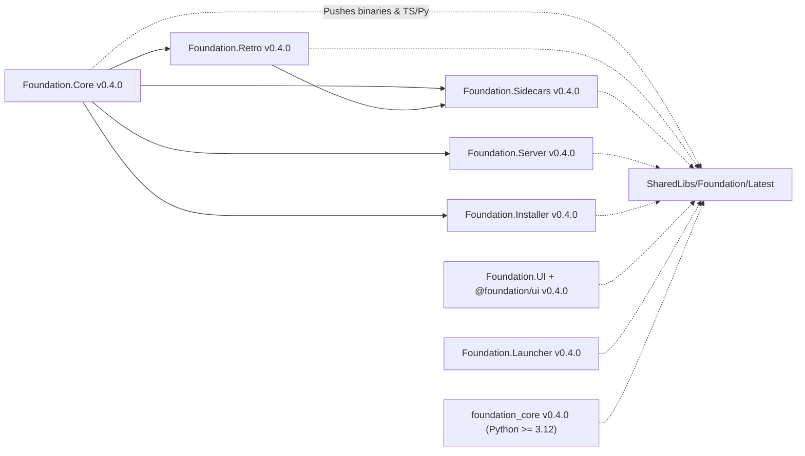

# Foundation (`v0.4.0`) — Architecture & File Registry

> **Audience:** Engineers and autonomous agents working on `<PROJECTS_ROOT>\Foundation\` or tracing internals referenced by consumer apps (`Housekeeping`, `ShadowLibrary`, `reStation`, `KingsFieldRecomp`, `MediaSync`).
> **Note for API Lookups:** If you only need public signatures, props, or CLI flags, read [`Dev\docs\INTERFACES.md`](file:///<PROJECTS_ROOT>/Foundation/Dev/docs/INTERFACES.md) first instead of opening source files.

---

## 1. System Overview & Assembly Dependency Topology

`Foundation` is the zero-duplication Shared SDK & Infrastructure Core (`v0.4.0`, `.NET 8`, React/TypeScript `@foundation/ui v0.4.0`, Python `foundation_core v0.4.0`) serving all companion apps under `<PROJECTS_ROOT>\`. Consumers treat both `<PROJECTS_ROOT>\Foundation\` and the published binary hub `<PROJECTS_ROOT>\SharedLibs\Foundation\Latest\` as **strictly read-only** during consumer development.

### 1.1 Subproject Dependency & Target Matrix

| Subproject | Target / Runtime | Depends On (Project / External) | Primary Role |
|---|---|---|---|
| `Foundation.Core` (`v0.4.0`) | `net8.0` | `Microsoft.Data.Sqlite 8.0.11`, `System.Security.Cryptography.ProtectedData 8.0.0` | Sandboxing (`ResolveSiblingSandboxRoot`, `--visible-test`), CLI/logs, atomic settings, DPAPI, SQLite WAL, locks, telemetry, crash dumps, jobs, hardened HTTP (`ResponseHeadersTimeout`, `416` recovery), tools, module loader, high-res frame pacer, SPSC audio ring buffer, WAV/PNG/RGBA overlay |
| `Foundation.Retro` (`v0.4.0`) | `net8.0` | `Foundation.Core` | 41-platform catalog (`IsVerifiedReferenceHash`), filename normalizer, Logiqx/Redump/RA/CMP DAT parser, headerless stripper + 20-magic sniff, IPS/BPS/UPS patcher, BYO media extractor, AOT-primary / `.decomp` contracts (`RecompTierAndBackendContracts.cs`) & fixture runner |
| `Foundation.Sidecars` (`v0.4.0`) | `net8.0` | `Foundation.Core`, `Foundation.Retro` | Single-pass CRC32/MD5/SHA1/SHA256 + headerless hasher, ZIP/7z `-slt` inspector (LZMA/Deflate64 fallback + nested `::` inspection) + TorrentZip, `.hash` v1 sidecars, `.hklock` sentinel |
| `Foundation.Server` (`v0.4.0`) | `net8.0-windows` | `Foundation.Core`, `Microsoft.AspNetCore.App` | Tiered Kestrel localhost/Tailscale/PBKDF2/HMAC cookie auth + Sister-App `/suite/manifest` endpoints |
| `Foundation.Launcher` (`v0.4.0`) | `net8.0-windows` | *(None — zero dependencies)* | Clean-root Win32 `AttachConsole(-1)` CLI/GUI shim launching `app\<App>.exe` with `--wait`/`--open`/`--visible-test` sync wait, relative arg rebase & Ctrl+C forwarding |
| `Foundation.Installer` (`v0.4.0`) | `net8.0-windows` (WinForms) | `Foundation.Core` | Tier 1 drop-in `StandardInstallerHost` + Dark Setup Wizard (`%LOCALAPPDATA%\Programs\<Studio>\<Suite?>\<App>\`, `InstallerProfileOption`, `SecondaryPathPickerOptions`, `--migrate-legacy`, `AllowAutoStart`, `--visible-test`, `FileLockRetryHelper`, sibling sandbox containment); Tier 2 `InstallerEngineCore` |
| `Foundation.UI` (`v0.4.0` Web) | `net8.0-windows` (WinForms) + React 19 / TS / Vanilla | `Microsoft.Web.WebView2 1.0.2903.40` (desktop); `react ^19` peer (web) | WebView2 disposable host, STA dialogs, tray badges, 10 React components (single canonical `Web\` source), Vanilla drawer + tokens |
| `foundation_core` (`v0.4.0`) | Python `>= 3.12` | *(Python standard library only)* | Parity CLI sandbox, atomic settings, heartbeat/capped logging, crash dumper, PID lock, SQLite WAL helper |

---

## 2. Core End-to-End Runtime Pipelines

1. **Startup & Fail-Closed Sandbox Pipeline:**
   `Program.cs` constructs `new SandboxEnvironment("myapp", args)` → resolves CLI flags (`--test-mode`, `--data-dir`, `--config`, `--log-dir`, `--port`, `--ui`) → asserts path containment inside sandbox root when contained → registers `CrashBundleService.RegisterGlobalHandlers(...)` → loads granular configs via `GranularSettingsManager.LoadOrSelfHeal(...)` → opens `SqliteWalPool` connections.
2. **Single-Pass Media & `.hash` v1 Sidecar Pipeline:**
   File is checked against `HkLockSentinel.IsTemporaryOrPartialFileName` + `.hklock` → `HeaderlessRomStripper.DetectHeaderSkipLength` inspects leading bytes → `SinglePassStreamHasher.HashFileSinglePassAsync` computes full + headerless CRC32/MD5/SHA1/(SHA256) in a single `ArrayPool<byte>` read pass → `HashSidecarService` persists or verifies `.hash` v1 / `COMPOSITE_SHA1`.
3. **Kestrel Tiered Request Auth Pipeline:**
   Incoming request hits `FoundationTieredAuthMiddleware` → skips public health/auth routes (`/api/v1/health`, `/api/v1/auth/*`) and non-protected SPA static routes → `TieredAuthEngine.EvaluateRequest` checks API token / direct loopback bypass (absent `X-Forwarded-For`) / Tailscale CGNAT (`100.64.0.0/10`) or ULA IPv6 + Serve headers / `HMAC-SHA256` session cookie → returns HTTP `401` with `requiresSetup` if unauthenticated.
4. **Two-Tier Drop-In Installer Pipeline (`v0.2.1`):**
   Setup executable calls `StandardInstallerHost.Run(new InstallerAppDescriptor(...), args)` → `--silent`/`--headless`/`--test-mode` enters `RunCliFlowAsync`, interactive GUI opens `InstallerWizardForm` → extracts embedded/external `payload.zip` via `InstallerEngine` (stopping running instances safely, writing `app\install-manifest.json`, preserving `data\` & `logs\`, creating `.lnk` shortcuts, ARP uninstall keys, and optional `-Uninstall.exe`).
5. **Hybrid Module Discovery Pipeline:**
   `HybridModuleLoader` scans host assemblies via `DiscoverFromAssemblies` (`FolderSlice`) and `app\modules\*.Module.*.dll` via `DiscoverExternalDllModules` (`DllModule`) → reads `IFoundationModule.SettingsSchema` → UI renders controls automatically with `SchemaSettingsRenderer`.
6. **SDK Hub Publish & Consumer Sync Pipeline:**
   `python Dev\tools\sync_foundation_sdk.py --publish-hub` copies compiled `Release\net8.0-windows` DLL/XML/PDB outputs, `@foundation/ui` TypeScript sources, and `foundation_core` into `<PROJECTS_ROOT>\SharedLibs\Foundation\Latest\` with `sdk-manifest.json` → `--sync-consumer <DevDir>` mirrors pinned libraries into consumer workspaces.

---

## 3. Complete File & `<= 400 LOC` Registry

Every source, build, test, and tooling file in `Dev\` (excluding build-mirrored `Foundation.UI\WebAssets\Web` / `components` copies and generated `bin/` / `obj/`) complies with **Standard 01 / 07 `<= 400 LOC`** (`max = 383 LOC` measured directly via `Get-Content`).

### 3.1 Solution Root (`Dev\`)

| File | LOC | Responsibility |
|---|---|---|
| [`Dev\Directory.Build.props`](file:///<PROJECTS_ROOT>/Foundation/Dev/Directory.Build.props) | 24 | Enforces `net8.0`, nullable/implicit usings, `Deterministic`, `ContinuousIntegrationBuild`, unified SDK `Version=0.4.0` |
| [`Dev\Foundation.sln`](file:///<PROJECTS_ROOT>/Foundation/Dev/Foundation.sln) | 60 | Visual Studio solution binding all 7 C# library projects + `Foundation.Tests` |

### 3.2 `Dev\src\Foundation.Core\` (`18` files + `.csproj`)

| File | LOC | Exported / Key Symbols |
|---|---|---|
| `Foundation.Core.csproj` | 13 | Package refs (`Microsoft.Data.Sqlite`, `ProtectedData`) |
| `AudioRingBuffer.cs` | 223 | `AudioRingBuffer` (lock-free SPSC `short`/`float` PCM + smooth ramp-to-zero underrun) |
| `CliAndProcessPrimitives.cs` | 172 | `CliArgumentHelper`, `BoundedTailStream` (64 KB), `CappedSharedLogSink` (4 MB) |
| `CrashBundleService.cs` | 197 | `CrashBundlePayload`, `CrashBundleService` (`crash_<appId>_<ts>.json`) |
| `DpapiSecretStore.cs` | 161 | `DpapiSecretStore` (`data\secrets.dpapi` CurrentUser protection) |
| `GranularSettingsManager.cs` | 257 | `SettingsLoadOutcome<T>`, `GranularSettingsManager` (`.tmp -> .bak`, 20 snapshots) |
| `HeartbeatLogger.cs` | 124 | `HeartbeatSnapshot`, `HeartbeatLogger` (`<= 15s`, `\r\x1b[K`) |
| `HighResFramePacer.cs` | 197 | `HighResFramePacer` (`winmm.dll` `timeBeginPeriod(1)`, sleep+spinwait, 120-frame FPS/P99) |
| `HybridModuleLoader.cs` | 166 | `DiscoveredModuleRecord`, `HybridModuleLoader` |
| `IFoundationModule.cs` | 57 | `ModuleType`, `SchemaSettingDescriptor`, `IFoundationModule` |
| `JobObjectGuard.cs` | 228 | `JobObjectGuard`, `DualJobCancellationCoordinator` |
| `PidSafeLockfile.cs` | 266 | `PidSafeLockEnvelope`, `PidSafeLockfile` |
| `PixelOverlayCanvas.cs` | 247 | `RgbaColor`, `PixelOverlayCanvas` (Porter-Duff `SrcOver`, 5×7 ASCII bitmap font) |
| `RgbaPngWriter.cs` | 133 | `RgbaPngWriter` (pure-.NET lossless RGBA PNG via `ZLibStream` + IEEE CRC32) |
| `SafeNetworkTransfer.cs` | 255 | `SafeTransferOptions`, `SafeTransferResult`, `SafeNetworkTransfer` |
| `SandboxEnvironment.cs` | 249 | `UiPresentationMode`, `SandboxEnvironment` (incl. `--visible-test`) |
| `SqliteWalPool.cs` | 116 | `SqliteWalPool` (`WAL`, `busy_timeout=15000`, `VACUUM INTO`) |
| `ToolResolver.cs` | 162 | `ToolResolutionSource`, `ToolResolutionResult`, `ToolResolver` |
| `WavCaptureWriter.cs` | 136 | `WavCaptureWriter` (16-bit PCM RIFF/WAV writer) |

### 3.3 `Dev\src\Foundation.Retro\` (`9` files + `.csproj`, `v0.4.0`)

| File | LOC | Exported / Key Symbols |
|---|---|---|
| `Foundation.Retro.csproj` | 12 | Project ref `Foundation.Core` (inherits `v0.4.0`) |
| `ConsoleSystemCatalog.cs` | 258 | `RetroBiosExpectation` (`IsVerifiedReferenceHash`), `RetroPlatformCatalogEntry`, `RetroHeaderSkipRule`, `RetroProvenanceTagRule`, `ConsoleSystemCatalog` |
| `DatTitleNormalizer.cs` | 335 | `ParsedRomFilenameMetadata`, `DatTitleNormalizer` |
| `HeaderlessRomStripper.cs` | 206 | `HeaderlessRomStripper`, `MagicBytePlatformDetector` |
| `MediaContainerExtractor.cs` | 315 | `MediaContainerFormat`, `MediaExtractionOptions`, `MediaExtractionResult`, `MediaContainerExtractor` |
| `NoIntroRedumpDatParser.cs` | 368 | `ParsedDatCatalogHeader`, `ParsedDatRomRecord`, `NoIntroRedumpDatParser` |
| `RecompContracts.cs` | 122 | `DiscChecksumEntry`, `IRecompModuleManifest`, `RecompTimingMode`, `RecompPatchDescriptor`, `RecompHostOptions`, `RecompFrameStats`, `IRecompRenderBackend`, `IRecompHost`, `IRecompGameModule`, `SaveStateFixtureSpec`, `VisibleTestShowcaseOptions`, `IVisibleTestHarness` |
| `RecompTierAndBackendContracts.cs` | 125 | `RecompExecutionTierMode`, `RecompRenderBackendIds`, `IDecompPackageManifest`, `RecompRuntimeTelemetrySnapshot`, `AotCacheLayoutHelper` |
| `SaveStateFixtureRunner.cs` | 185 | `SaveStateFixtureFrameOutput`, `SaveStateFixtureResult`, `SaveStateFixtureRunner` |
| `SoftPatchEngine.cs` | 298 | `SoftPatchEngine` (IPS, `BPS1`, `UPS1`, CRC32) |

### 3.4 `Dev\src\Foundation.Sidecars\` (`4` files + `.csproj`)

| File | LOC | Exported / Key Symbols |
|---|---|---|
| `Foundation.Sidecars.csproj` | 17 | Project refs `Foundation.Core`, `Foundation.Retro` |
| `HashSidecarService.cs` | 287 | `SidecarDocument`, `HashSidecarService` (`.hash` v1, `COMPOSITE_SHA1`) |
| `HkLockSentinel.cs` | 181 | `HkLockEnvelope`, `HkLockSentinel` (`.hklock`, `.coexistence.json` v2) |
| `SevenZipAndZipInspector.cs` | 383 | `InspectedArchiveEntry`, `SevenZipAndZipInspector` *(largest file in repo: 383 <= 400 LOC)* |
| `SinglePassStreamHasher.cs` | 187 | `ComputedStreamHashes`, `Crc32Accumulator`, `SinglePassStreamHasher` |

### 3.5 `Dev\src\Foundation.Server\` & `Foundation.Launcher\` (`4` files + 2 `.csproj`)

| File | LOC | Exported / Key Symbols |
|---|---|---|
| `Foundation.Server.csproj` | 17 | FrameworkReference `Microsoft.AspNetCore.App`, ref `Foundation.Core` |
| `SisterAppStandardEndpoints.cs` | 52 | `SisterAppStandardEndpoints` (`/api/v1/suite/manifest`, `/api/suite/manifest`, `/suite.manifest.json`) |
| `TieredAuthEngine.cs` | 285 | `TieredAuthConfigSnapshot`, `TieredAuthEvaluation`, `TieredAuthEngine` |
| `TieredAuthMiddleware.cs` | 57 | `FoundationTieredAuthMiddleware` |
| `Foundation.Launcher.csproj` | 12 | `net8.0-windows`, zero external deps |
| `RootLauncherHost.cs` | 142 | `RootLauncherHost` (Win32 `AttachConsole(-1)`, fail-closed self-spawn guard) |

### 3.6 `Dev\src\Foundation.Installer\` (`15` files + `.csproj`, `v0.2.2`)

| File | LOC | Role |
|---|---|---|
| `Foundation.Installer.csproj` | 17 | `UseWindowsForms`, ref `Foundation.Core`, `v0.2.2` |
| `FileLockRetryHelper.cs` | 102 | Bounded 10-attempt lock retry (`150/250/500ms`) + safe Sandbox/Temp path check |
| `StandardInstallerHost.cs` | 345 | **Tier 1** CLI + interactive GUI + `--visible-test` showcase entry point |
| `InstallerEngine.Core.cs` | 376 | `InstallerAppDescriptor` (`AllowAutoStart`), `InstallManifest`, `InstallerSandboxContext`, `InstallerEngine` |
| `InstallerEngine.InstallAndExtract.cs` | 236 | Process shutdown, ZIP payload extraction, retry-guarded file ops, data/log preservation |
| `InstallerEngine.TestModeAndCli.cs` | 175 | Headless/sandbox verification & console progress hooks |
| `InstallerEngine.UninstallAndShortcuts.cs` | 259 | ARP uninstall registry keys, `.lnk` shortcuts, clean removal |
| `InstallerEngine.VerifyAndUpgrade.cs` | 74 | SHA-256 payload & installed file verification |
| `InstallerWizardForm.cs` | 334 | 650×434 Dark WinForms Setup Wizard main controller (`AllowAutoStart`, showcase timer) |
| `InstallerWizardForm.ExecutionAndLogs.cs` | 278 | Live step progress & installer log drawer |
| `InstallerWizardForm.LayoutAndTheme.cs` | 329 | Dark card/accent WinForms theme, checkbox rebalancing & layout |
| `InstallerWizardControls.cs` | 105 | Styled buttons, cards & progress controls |
| `WindowsShortcutWriter.cs` | 216 | COM `IShellLinkW` shortcut creator |
| `InstallerThemeOptions.cs` | 71 | **Tier 2** visual customization DTO (`AllowAutoStart`, `InstallerCustomToggle`, `InstallerThemeOptions`) |
| `InstallerEngineCore.cs` | 276 | **Tier 2** core clean-root helper (`FoundationInstallManifest`) |
| `InstallerEngineCore.BackupAndVerify.cs` | 250 | **Tier 2** data backup/restore & integrity verify |

### 3.7 `Dev\src\Foundation.UI\` (`20` core files + `.csproj`, `@foundation/ui v0.4.0`)

| File | LOC | Exported / Key Symbols |
|---|---|---|
| `Foundation.UI.csproj` | 29 | `WebView2 1.0.2903.40`, copies `Web\` to `$(OutputPath)\WebAssets\`, gated `SyncFoundationWebAndSharedLibs` (`PublishFoundationSdk=true`) |
| `ShellBrandingOptions.cs` | 51 | `ShellBrandingOptions` |
| `Desktop\DisposableWebViewHostForm.cs` | 61 | `DisposableWebViewHostForm` |
| `Desktop\StaNativeDialogBridgeBase.cs` | 191 | `StaNativeDialogBridgeBase` |
| `Desktop\TrayIconBadgeHelper.cs` | 56 | `TrayIconBadgeHelper` |
| `Web\package.json` & `Web\index.ts` | 14 / 51 | `@foundation/ui v0.4.0` barrel (exports 7 of 10 React components + drawer utils) |
| `Web\components\GlobalTerminalDrawer.tsx` | 291 | `GlobalTerminalDrawer` |
| `Web\components\TerminalToolbarAndFilters.tsx` | 275 | `TerminalToolbarAndFilters` |
| `Web\components\terminalDrawerCore.ts` | 162 | Line level/subsystem classifier, timestamp formatter, `.log` exporter |
| `Web\components\UniversalDataTable.tsx` | 238 | `UniversalDataTable` |
| `Web\components\HybridPathPicker.tsx` | 215 | `HybridPathPicker` *(direct submodule import only)* |
| `Web\components\SchemaSettingsRenderer.tsx` | 171 | `SchemaSettingsRenderer` |
| `Web\components\ModalDialog.tsx` | 161 | `ModalDialog`, `ConfirmActionModal` |
| `Web\components\SidebarNavRail.tsx` | 158 | `SidebarNavRail` *(direct submodule import only)* |
| `Web\components\CoexistenceWarningBanner.tsx` | 150 | `CoexistenceWarningBanner` *(direct submodule import only)* |
| `Web\components\StyledTooltip.tsx` | 121 | `StyledTooltip` |
| `Web\components\ResponsiveTable.tsx` | 50 | `ResponsiveTable` |
| `WebAssets\foundation-shell.ts` | 58 | WebView2 / Browser host bridge |
| `WebAssets\foundation-tokens.css` | 117 | Canonical surface/accent/responsive CSS variables |
| `WebAssets\foundation-terminal.js` & `.css` | 305 / 111 | Vanilla JS `FoundationTerminalDrawer` & styling |

*(Note: `Web\` is the single canonical TS/TSX source tree; `WebAssets\` holds only vanilla JS/CSS assets in source, and `sync_foundation_sdk.py` merges both into `WebAssets\` at SDK publish time.)*

### 3.8 `Dev\src\foundation_core\` (`8` files, Python `v0.4.0`) & `Dev\tools\` (`4` files)

| File | LOC | Key Symbols / Purpose |
|---|---|---|
| `foundation_core\pyproject.toml` & `__init__.py` | 13 / 32 | Package metadata (`foundation-core v0.4.0`) |
| `foundation_core\cli.py` | 63 | `UiMode`, `SandboxPaths`, `resolve_sandbox_paths` |
| `foundation_core\settings.py` | 87 | `SettingsLoadResult`, `GranularSettingsStore` |
| `foundation_core\logging.py` | 68 | `HeartbeatTracker`, `CappedLogFile` |
| `foundation_core\crash_dumper.py` | 80 | `CrashDumper` |
| `foundation_core\locks.py` | 74 | `PidSafeLock` |
| `foundation_core\db.py` | 83 | `SqliteWalHelper` |
| `tools\sync_foundation_sdk.py` | 240 | Publish hub (`SharedLibs\Foundation\Latest`), `purge_stale_pdbs`, `stage_clean_release_bundle`, & sync consumers |
| `tools\build_release_universal.py` | 82 | Universal C#/WinForms release & `Releases\Latest` bundler |
| `tools\verify_sandbox_universal.py` | 69 | Headless `--test-mode` sandbox verifier |
| `tools\notion_task_helper.py` | 77 | Standard 16 Notion Task Backbone helper (`resolve_notion_ids` via env/`notion.config.json`) |

---

## 4. SQLite WAL Concurrency & Security Invariants

- **SQLite MVCC Configuration (`SqliteWalPool.cs#L36-L75` & `foundation_core\db.py`):**
  - `Cache = SqliteCacheMode.Default` (explicitly avoids `Shared` cache table locks under async multi-reader workloads).
  - `PRAGMA journal_mode = WAL;`
  - `PRAGMA busy_timeout = 15000;` (15s retry window before `SQLITE_BUSY`)
  - `PRAGMA synchronous = NORMAL;`
  - `PRAGMA foreign_keys = ON;`
  - `PRAGMA temp_store = MEMORY;`
  - `PRAGMA cache_size = -65536;` (~64 MB page cache)
  - Online backups execute `VACUUM INTO` into a temporary file followed by atomic replace.
- **Security & Containment Boundaries:**
  - `SandboxEnvironment.AssertPathContained` canonicalizes full paths and aborts traversal outside `Sandbox\`.
  - `DpapiSecretStore` encrypts API tokens and Discord webhooks under Windows `DataProtectionScope.CurrentUser` so secrets never rest in plaintext `settings.json`.
  - `PidSafeLockfile` and `HkLockSentinel` verify both PID and `ProcessStartTimeUtc` to defeat OS PID reuse on crash recovery.
  - `TieredAuthEngine` disables localhost bypass when `X-Forwarded-For` is present (protecting reverse proxies), limits Tailscale bypass to `100.64.0.0/10` / `fd7a:115c:a1e0::/48`, hashes passwords with PBKDF2-SHA256 (`100,000` iterations), and signs session cookies with HMAC-SHA256.

---

## 5. Unit Test Suite (`26` `[Fact]` Tests across 5 Files)

| Test File (`Dev\tests\Foundation.Tests\`) | LOC | Count | Verified Coverage |
|---|---|---|---|
| `FoundationCoreTests.cs` | 243 | 6 `[Fact]`s | `SandboxEnvironment` containment/flags, `GranularSettingsManager` `.bak` heal + 20-snapshot trim, `DpapiSecretStore` Windows round-trip, `PidSafeLockfile` contention + orphan breaking, `HeartbeatLogger` `\r\x1b[K` + 15s cap, `SqliteWalPool` WAL pragmas + `VACUUM INTO` |
| `FoundationSettingsAndInstallerTests.cs` | 270 | 5 `[Fact]`s | `InstallerEngineCore` contained install + `data\` preservation on upgrade, `CrashBundleService` JSON dump, `DualJobCancellationCoordinator` StopCurrent vs StopAll, `SafeNetworkTransfer` HTTP Range `.partial_<jobId>` resume + disk preflight, `StandardInstallerHost` Tier 1 `--silent --test-mode` end-to-end extract/verify/uninstall |
| `FoundationDecouplingTests.cs` | 150 | 4 `[Fact]`s | `HybridModuleLoader` slice & assembly discovery, `ToolResolver` 4-tier priority, `BoundedTailStream` 64 KB ring + `CappedSharedLogSink` 4 MB cap, `TieredAuthEngine` loopback/`X-Forwarded-For`/PBKDF2/HMAC cookie verification |
| `FoundationTerminalDrawerTests.cs` | 200 | 3 `[Fact]`s | `terminalDrawerCore` line level/subsystem classification, search/verbosity filtering, dual-token button contract verification, `sync_foundation_sdk.py` `v0.3.1` publish & sync |
| `FoundationV031PrimitivesTests.cs` | 331 | 8 `[Fact]`s | `HighResFramePacer`, `AudioRingBuffer`, `WavCaptureWriter`, `RgbaPngWriter`, `PixelOverlayCanvas`, `SandboxEnvironment.VisibleTest`, `MediaContainerExtractor`, `RecompContracts`, `SaveStateFixtureRunner`, `AllowAutoStart = false`, `FileLockRetryHelper`, `--test-mode --install-dir` containment, `--visible-test` showcase |

---

## 6. Architectural Decision Records & Extension Playbooks

### 6.1 Key ADRs
- **ADR-001 (Zero App Domain Coupling):** `Foundation` may never reference `Housekeeping`, `ShadowLibrary`, `reStation`, or `MediaSync` specifics; domain rules belong in callers via descriptors (`InstallerAppDescriptor`, `SchemaSettingDescriptor`, `IReadOnlyList<RetroPlatformCatalogEntry>`).
- **ADR-002 (400 LOC File Cap):** All source files remain under 400 lines (`max = 383 LOC`) via partial-class splits (`InstallerEngine.*.cs`) and focused modules.
- **ADR-003 (Consumer Read-Only Fence):** Companion app sessions cannot mutate `<PROJECTS_ROOT>\Foundation\` or `SharedLibs\Foundation\`; upstream fixes are logged in `Dev\docs\reports\` and executed only in a dedicated `Foundation` session.
- **ADR-004 (`SqliteCacheMode.Default` + `15000 ms` busy timeout):** Prevents shared-cache read/write deadlocks across background indexers and web UI API requests.
- **ADR-005 (Dual-Scope Job Cancellation):** Separating active-job cancellation from queue drain (`DualJobCancellationCoordinator` + `TerminalToolbarAndFilters`) preserves queued jobs when stopping a stuck item.
- **ADR-006 (Two-Tier Installer Split):** Retaining `InstallerEngineCore` (`v0.2.0`) underneath while promoting `StandardInstallerHost` (`v0.2.1`) lets tiny apps adopt the full dark wizard in 15 lines without breaking existing custom hosts.
- **ADR-007 (Sidecar & Directory Coexistence Protocol):** `.hash` v1 and `.hklock` use identical schemas across `Housekeeping` and `ShadowLibrary` via `Foundation.Sidecars`.
- **ADR-008 (Side-Effect Warning on `Foundation.UI.csproj`):** Building `Foundation.UI.csproj` triggers `SyncFoundationWebAndSharedLibs`, which copies built assets to `<PROJECTS_ROOT>\SharedLibs\Foundation\Latest\`. Never run casual builds during documentation-only audits.

### 6.2 How to Add a New Shared Helper Without Breaking Consumers
1. Implement the module in the lowest applicable assembly (`Foundation.Core` if pure .NET, `Foundation.Retro` if retro-specific, etc.) in `<= 400` LOC.
2. Add `[Fact]` unit tests under `Dev\tests\Foundation.Tests\`.
3. Update [`Dev\docs\INTERFACES.md`](file:///<PROJECTS_ROOT>/Foundation/Dev/docs/INTERFACES.md) and [`Dev\docs\ARCHITECTURE.md`](file:///<PROJECTS_ROOT>/Foundation/Dev/docs/ARCHITECTURE.md).
4. Explicitly publish when authorized (`dotnet test` + `python Dev\tools\sync_foundation_sdk.py --publish-hub`) and verify `SharedLibs\Foundation\Latest\sdk-manifest.json`.
