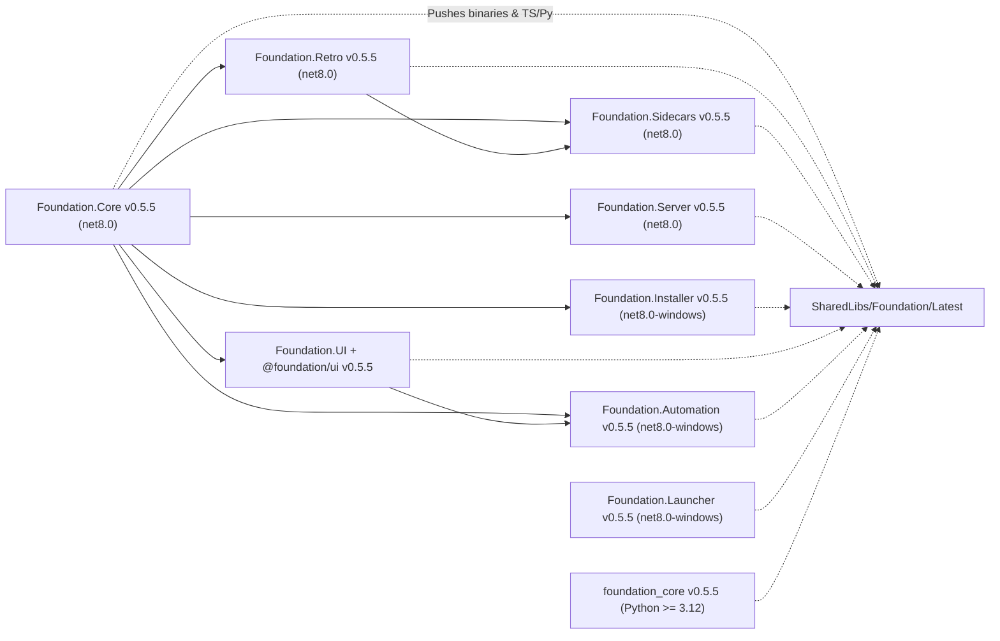

# Foundation (`v0.5.5`) — Architecture & File Registry

> **Audience:** Engineers and autonomous agents working on `<PROJECTS_ROOT>\Foundation\` or tracing internals referenced by consumer apps (`Housekeeping`, `ShadowLibrary`, `reStation`, `KingsFieldRecomp`, `MediaSync`, `NeuroPlay`).
> **Note for API Lookups:** If you only need public signatures, props, schemas, or CLI flags, read [`Dev\docs\INTERFACES.md`](INTERFACES.md) first instead of opening source files.

---

## 1. System Overview & Assembly Dependency Topology

`Foundation` is the zero-duplication Shared SDK & Infrastructure Core (`v0.5.5`, `.NET 8`, React/TypeScript `@foundation/ui v0.5.5`, Python `foundation_core v0.5.5`) organized in **Tier A (4-Folder)** layout serving companion apps under `<PROJECTS_ROOT>\`. Consumers treat `<PROJECTS_ROOT>\Foundation\` and `<PROJECTS_ROOT>\SharedLibs\Foundation\Latest\` as **strictly read-only** during consumer development.

### 1.1 Subproject Dependency & Target Matrix

| Subproject | Target / Runtime | Depends On (Project / External) | Primary Role |
|---|---|---|---|
| `Foundation.Core` (`v0.5.5`) | `net8.0` | `Microsoft.Data.Sqlite 8.0.11`, `System.Security.Cryptography.ProtectedData 8.0.0`, in-box `Microsoft.Win32.Registry` | Runtime environment (`AppEnvironment`, `SandboxEnvironmentSeam` w/ Windows 8.3 `GetLongPathNameW`, `KnownFolderPaths`, `SandboxDriveController`), atomic JSON pseudo-registry (`IPlatformRegistry`, `JsonHivePlatformRegistry`, `WindowsPlatformRegistry`), `RollingFileBackupStore`, `HighResFramePacer` (+ VRR late-latch), `SafeNetworkTransfer` (Standard 41 HTTPS/SSRF + DNS/redirect guards), CLI/logs, atomic settings, DPAPI, SQLite WAL, locks, telemetry, crash dumps, jobs, tools, module loader, SPSC audio, WAV/PNG/RGBA overlay, `QrCodeEncoder` |
| `Foundation.Retro` (`v0.5.5`) | `net8.0` | `Foundation.Core` | 41-platform catalog, filename normalizer, Logiqx/Redump/RA/CMP DAT parser, headerless stripper + 20-magic sniff, IPS/BPS/UPS patcher, BYO media extractor, AOT-primary / `.decomp` contracts |
| `Foundation.Sidecars` (`v0.5.5`) | `net8.0` | `Foundation.Core`, `Foundation.Retro` | Single-pass CRC32/MD5/SHA1/SHA256 + headerless hasher, ZIP/7z `-slt` inspector + TorrentZip, `.hash` v1 sidecars, `.hklock` sentinel |
| `Foundation.Server` (`v0.5.5`) | `net8.0` | `Foundation.Core`, `Microsoft.AspNetCore.App` | Tiered Kestrel localhost/Tailscale/PBKDF2/HMAC cookie auth + Sister-App `/suite/manifest` endpoints |
| `Foundation.Launcher` (`v0.5.5`) | `net8.0-windows` | *(None — zero dependencies)* | Clean-root Win32 `AttachConsole(-1)` CLI/GUI shim launching `app\<App>.exe` with extensible `RootLauncherOptions` sync/value/path flags, relative arg rebase & Ctrl+C forwarding |
| `Foundation.Installer` (`v0.5.5`) | `net8.0-windows` (WinForms) | `Foundation.Core` | Tier 1 drop-in `StandardInstallerHost` (`ExitCode = 3` containment, `ProductName` ownership guard across Tier 1 & Tier 2, wildcard-free uninstaller cleanup, Dual Online/Offline Setup + `--offline-bundle`), `InstallerManifestStore` (`schemaVersion: 2`, `suiteId`, `installerDeliveryKind`, `payloadAssets[]`, tooltips), self-healing `LastInstallBaseDir`, Dark Setup Wizard (`FOREIGN APP DETECTED` badge); Tier 2 `InstallerEngineCore` |
| `Foundation.Automation` (`v0.5.5`) | `net8.0-windows` (WinForms host; WinForms-free `IAutomationSurfaceTarget`) | `Foundation.Core`, `Foundation.UI` | Opt-in `127.0.0.1` HTTP/JSON loopback (`--automation-port`, bearer `401`, `Host`/`Origin` `403`), `IAutomationSurfaceTarget` + `WinFormsAutomationSurfaceTarget`, focus-free Win32 virtual pointer/keyboard & `inspectTree`, offscreen PNG capture (`POST /v1/snapshot` & in-memory `GET /v1/snapshot.png`) |
| `Foundation.UI` (`v0.5.5` Web) | `net8.0-windows` (WinForms) + React 19 / TS / Vanilla | `Foundation.Core`, `Microsoft.Web.WebView2 1.0.2903.40`; `react ^19` peer | `DisposableWebViewHostForm`, STA dialogs, tray badges, `ShellBrandingOptions` (`SdkVersion = "0.5.5"`), 10 React components, Vanilla drawer + tokens |
| `foundation_core` (`v0.5.5`) | Python `>= 3.12` | *(Python standard library only)* | Parity CLI (`add_help=False`, `config/settings.json`), 4-drive sandbox seam (`sandbox_seam.py` w/ 8.3 & child `USERPROFILE` fixes), JSON pseudo-registry, `GranularSettingsStore` (Std 19), Std 35 logging & 30d prune, Std 43 Zero-PII crash dumper, `±2s` PID-reuse guard locks, `PRAGMA user_version` SQLite WAL/migrations, pure-stdlib `AutomationLoopbackServer` |

---

## 2. Core End-to-End Runtime Pipelines

1. **Startup, Known-Folder & 4-Drive Sandbox Containment Pipeline:**
   `AppEnvironment` resolves CLI flags (`--data-dir`, `--config`, `--log-dir`, `--port`, UI modes) and attaches `SandboxResolution` via `SandboxEnvironmentSeam.ResolveCurrent()` (inspecting process env only: `FOUNDATION_SANDBOX_ROOT`, `SANDBOX_*_DRIVE`, `FOUNDATION_SANDBOX_PROFILE_DIR`, with `APP_ISOLATED_TEST=1` always beating `FOUNDATION_SANDBOX_ROOT`). When Stage 2 is active, `KnownFolderPaths` redirects `UserProfile`, `LocalApplicationData`, `ApplicationData`, `Desktop`, `Personal`, `Programs`, `StartMenu`, `Startup`, `ProgramFiles*`, `CommonApplicationData`, and `Windows` inside the sandbox, while `AssertSandboxPathIfActive` rejects host escapes with `ExitCode = 3`.
2. **3-Mode Installer & Cross-Process Atomic Pseudo-Registry Pipeline:**
   `StandardInstallerHost` and `InstallerEngineCore` evaluate 3 modes: **Host Live** (`IsSandboxActive=false`, `IsStage1Isolated=false`), **Stage 1 Isolated** (`ShouldSuppressHostMutations=true`, `ShouldSuppressLiveHostMutations=true`), and **Stage 2 Sandbox** (`IsSandboxActive=true`, `ShouldSuppressHostMutations=false`, `ShouldSuppressLiveHostMutations=true`). Stage 2 installs to `<SandboxDDrive>\Programs\...`, sanitizes `.lnk` names via `WindowsShortcutWriter.SanitizeShortcutFileName`, and persists `HKCU`/`HKLM`/`HKCR` entries through `JsonHivePlatformRegistry` (`<SandboxRoot>\registry\registry.hive.json`) coordinated across C# and Python via named `Mutex` + `PidSafeLockfile` (`registry.hive.lock`) + `.tmp -> fsync/Flush(true) -> .bak -> replace`.
3. **4-Drive Sandbox Orchestration & Stage 2 12-Point E2E Pipeline:**
   `Dev\tools\sandbox_ctl.py` (using `SandboxDriveController` semantics: `CLI -> env -> Dev\.env -> %USERPROFILE%\.gemini\.secrets\.env` + dynamic `subst` parsing) initializes `C`/`D`/`E` mounts, ISO virtual optical checks, `sandbox.manifest.json`, and `registry.baseline.json` -> `registry.hive.json`. `Dev\tools\run_sandbox_e2e.py` executes `S2-01`..`S2-12` against real installers/apps with scrubbed child environments (`FOUNDATION_SUPPRESS_MODALS=1`) and emits a Standard 18 JSON receipt (`hostDiffCount == 0`).
4. **Single-Pass Media, Kestrel Auth & Hybrid Module Pipelines:**
   `Foundation.Sidecars` + `Foundation.Retro` hash and extract containers (`ArrayPool<byte>`, `.hash` v1, `.hklock`), `Foundation.Server` evaluates localhost/Tailscale/PBKDF2/HMAC auth, and `HybridModuleLoader` discovers in-assembly slices and `*.Module.*.dll` plugins.
5. **SDK Publish, 6-File Release Bundle & Consumer Sync Pipeline:**
   `Dev\tools\sync_foundation_sdk.py --publish` outputs binaries, `@foundation/ui`, `foundation_core`, and `Dev\tools\` to `SharedLibs\Foundation\v0.5.5\`, `Latest\`, and `Builds\v0.5.5\app\` (zero `AGENTS.md`, `app\LICENSE` included), and stages a strict 6-file `Releases\Latest\` bundle via atomic hardlink-safe `generate_sha256sums` (`Foundation-v0.5.5.zip` + `README.md` + `FEATURES.md` + `RELEASE_NOTES.md` + `CHANGELOG.md` + `SHA256SUMS.txt` — no loose `LICENSE` in `Releases\`), verified via `build_release_universal.py --allow-sdk-zip` (while app bundles also support `--allow-portable-zip` 7-file and `--allow-dual-installer` 8-file validation). `--sync-consumer` updates consumer `Dev\lib\` while preserving `sandbox_seam.py`/`sandbox_ctl.py`/`run_sandbox_e2e.py`/`exebox_stream.py`/`ExeboxStreamHelpers.ps1` and removing only retired legacy sandbox test artifacts.

---

## 3. Complete File & Code-Only SLOC Registry (`<= 400 SLOC`)

Every production source and tool file complies with **Standard 32 `250 / 400 / 600` Code-Only SLOC**.

### 3.1 Solution Root (`Dev\`)

| File | SLOC (Raw) | Responsibility |
|---|---|---|
| `Dev\Directory.Build.props` | `23` (`24`) | Enforces `.NET 8`, nullable/implicit usings, `Deterministic`, `ContinuousIntegrationBuild`, `Version=0.5.5` (`0.5.5.0`) |
| `Dev\Foundation.code-workspace` | — | Multi-root IDE workspace (`Dev\` + Project Root), `.NET` / Python tasks, file excludes & extension recommendations |
| `Dev\app.manifest.json` | `28` (`28`) | Standard 40 `standalone-app` manifest (`version: "0.5.5"`, `sdkVersion: "0.5.5"`, `containerTier: "Tier A (4-Folder)"`) |
| `Dev\.env.example` | `17` (`21`) | Optional SharedLibs, Notion, and empty Stage 2 4-drive sandbox overlay placeholders |
| `Dev\Foundation.sln` | — (`66`) | Solution binding all 8 C# projects + `Foundation.Tests` |

### 3.2 `Dev\src\Foundation.Core\` (`27` `.cs` files + `.csproj`, `net8.0`)

| File | SLOC (Raw) | Exported / Key Symbols |
|---|---|---|
| `Foundation.Core.csproj` | `12` (`13`) | `net8.0`, `Microsoft.Data.Sqlite 8.0.11`, `ProtectedData 8.0.0`, in-box `Microsoft.Win32.Registry` |
| `AppEnvironment.cs` | `212` (`254`) | `UiPresentationMode`, `AppEnvironment` (`Sandbox`, 4-arg ABI + 5-arg `sandboxOverride`), `AssertPathContained`, `NormalizeLongPath` |
| `SandboxEnvironmentSeam.cs` | `285` (`334`) | `SandboxMountSpec`, `SandboxResolution`, `SandboxEnvironmentSeam` (`ContainmentExitCode = 3`, process-env resolve, `TryToLongPath` 8.3 normalization, `AssertSandboxPathIfActive`, `subst` backing resolution) |
| `KnownFolderPaths.cs` | `240` (`276`) | `KnownFolderPaths` (`GetFolderPath`, `GetHostFolderPath` w/ child-`USERPROFILE` Desktop/Documents unmapping, `ResolveLocalProgramsDirectory`, `MapHostPathToSandbox`) |
| `IPlatformRegistry.cs` | `157` (`181`) | `PlatformRegistryHive`, `PlatformRegistryValueKind`, `PlatformRegistryValue`, `IPlatformRegistry`, `NoOpPlatformRegistry` |
| `WindowsPlatformRegistry.cs` | `169` (`202`) | `WindowsPlatformRegistry` (`[SupportedOSPlatform("windows")]` in-box registry wrapper) |
| `JsonHivePlatformRegistry.cs` | `233` (`269`) | `JsonHivePlatformRegistry` (Standard 18 JSON hive, Mutex + `PidSafeLockfile`, `.tmp -> .bak`), `PlatformRegistryFactory` |
| `SandboxDriveController.cs` | `196` (`241`) | `SandboxDriveController` (opt-in `.env`/`.secrets\.env` loader, `GetSubstMappings`, `InferSandboxRoot`, `ResolveDriveMounts`, `ValidateNoHostCollisions`) |
| `AudioRingBuffer.cs` | `177` (`223`) | `AudioRingBuffer` (lock-free SPSC PCM + underrun ramp) |
| `CliAndProcessPrimitives.cs` | `147` (`172`) | `CliArgumentHelper`, `BoundedTailStream`, `CappedSharedLogSink` |
| `CrashBundleService.cs` | `158` (`197`) | `CrashBundlePayload`, `CrashBundleService` (`crash_<appId>_<ts>.json`) |
| `DpapiSecretStore.cs` | `135` (`161`) | `DpapiSecretStore` (`data\secrets.dpapi` CurrentUser protection) |
| `GranularSettingsManager.cs` | `218` (`257`) | `SettingsLoadOutcome<T>`, `GranularSettingsManager` (`.tmp -> .bak`, 20 snapshots) |
| `HeartbeatLogger.cs` | `103` (`124`) | `HeartbeatSnapshot`, `HeartbeatLogger` (`<= 15s`, `\r\x1b[K`) |
| `HighResFramePacer.cs` | `279` (`338`) | `HighResFramePacer` (`timeBeginPeriod(1)`, sleep+spinwait, P99, VRR late-latch `BeginLateLatchFrame` / `WaitBeforePresent*`) |
| `HybridModuleLoader.cs` & `IFoundationModule.cs` | `135` / `28` | `DiscoveredModuleRecord`, `HybridModuleLoader`, `ModuleType`, `SchemaSettingDescriptor`, `IFoundationModule` |
| `JobObjectGuard.cs` | `181` (`228`) | `JobObjectGuard`, `DualJobCancellationCoordinator` |
| `PidSafeLockfile.cs` | `212` (`266`) | `PidSafeLockEnvelope`, `PidSafeLockfile` |
| `PixelOverlayCanvas.cs` & `RgbaPngWriter.cs` | `207` / `109` | `RgbaColor`, `PixelOverlayCanvas`, `RgbaPngWriter` |
| `QrCodeEncoder.cs` | `379` (`427`) | `QrCodeMatrix`, `QrCodeEncoder` (ISO/IEC 18004 V1–V10 ECC-M byte-mode + GF(256) RS + 4-module SVG renderer) |
| `RollingFileBackupStore.cs` | `247` (`292`) | `RollingBackupEntry`, `RollingBackupCommitResult`, `RollingFileBackupStore` (`DefaultMaxBackups = 10`, atomic `.tmp -> .bak` rotating history) |
| `SafeNetworkTransfer.cs` & `.Validation.cs` | `274` / `172` | `SafeTransferOptions`, `SafeTransferResult`, `SafeNetworkTransfer` (`DownloadVerifiedAsync`, `ValidateRequestUri`, `IsBlockedSsrfAddress`, `AllowAutoRedirect = false`, TLS 1.2/1.3, DNS IP `ConnectCallback`, `ExpectedSizeBytes`) |
| `SqliteWalPool.cs`, `ToolResolver.cs`, `WavCaptureWriter.cs` | `92` / `131` / `106` | `SqliteWalPool`, `ToolResolver`, `WavCaptureWriter` |

### 3.3 `Foundation.Retro`, `Foundation.Sidecars`, `Foundation.Server`, `Foundation.Launcher` & `Foundation.UI`

- **`Dev\src\Foundation.Retro\` (`net8.0`, `8` files):** `ConsoleSystemCatalog.cs` (`265` raw), `DatTitleNormalizer.cs` (`335` raw), `HeaderlessRomStripper.cs` (`206` raw), `MediaContainerExtractor.cs` (`321` raw), `NoIntroRedumpDatParser.cs` (`368` raw), `RecompContracts.cs` (`88` raw), `RecompTierAndBackendContracts.cs` (`125` raw), `SoftPatchEngine.cs` (`298` raw).
- **`Dev\src\Foundation.Sidecars\` (`net8.0`, `5` files):** `HashSidecarService.cs` (`287` raw), `HkLockSentinel.cs` (`181` raw), `SevenZipAndZipInspector.cs` (`208` raw), `SevenZipAndZipInspector.ExtractAndZip.cs` (`258` raw), `SinglePassStreamHasher.cs` (`187` raw).
- **`Dev\src\Foundation.Server\` (`net8.0`, `3` `.cs` + `.csproj`):** `Foundation.Server.csproj` (`13` LOC, `net8.0` + `Microsoft.AspNetCore.App`), `SisterAppStandardEndpoints.cs` (`52` raw), `TieredAuthEngine.cs` (`285` raw), `TieredAuthMiddleware.cs` (`57` raw).
- **`Dev\src\Foundation.Launcher\` (`net8.0-windows`, `2` `.cs` + `.csproj`):** `RootLauncherHost.cs` (`277` SLOC / `330` raw), `RootLauncherOptions.cs` (`9` SLOC / `16` raw).
- **`Dev\src\Foundation.UI\` (`net8.0-windows` + `@foundation/ui v0.5.5`):** `Foundation.UI.csproj` (`28` LOC), `ShellBrandingOptions.cs` (`21` SLOC / `51` raw, `SdkVersion = "0.5.5"`), `Desktop\{DisposableWebViewHostForm,StaNativeDialogBridgeBase,TrayIconBadgeHelper}.cs`, `Web\package.json` (`14` LOC, `0.5.5`) + `Web\index.ts` + 10 React components + `WebAssets\*`.

### 3.4 `Dev\src\Foundation.Installer\` (`20` `.cs` + `.csproj`, `net8.0-windows`) & `Dev\src\Foundation.Automation\` (`5` `.cs` + `.csproj`, `net8.0-windows`)

| File | SLOC (Raw) | Role |
|---|---|---|
| `FileLockRetryHelper.cs` | `125` (`152`) | 10-attempt lock retry + `SandboxResolution?`-aware `IsSafeIsolatedInstallDirectory` & `IsCanonicalProductionOrSystemPath` |
| `InstallerManifestStore.cs` | `303` (`343`) | Loads Standard 40 `schemaVersion: 2` `installer.manifest.json` (`suiteId` + legacy `suiteName`, `installerDeliveryKind`, `payloadDownloadUrl`, `payloadAssets[]`, `layoutMode`, `supportedProfiles`, tooltips) |
| `InstallerContracts.cs` | `215` (`268`) | `InstallerDeliveryKinds`, `InstallerPayloadAsset`, `InstallerAppDescriptor`, `InstallerInstallOptions` (`OfflineBundlePath`), `InstallerMarkup*`, `InstallManifest`, `InstallerHostRunResult` |
| `InstallerRuntimeContext.cs` | `132` (`157`) | 3-mode precedence (`IsSandboxActive`, `IsStage1Isolated`, `ShouldSuppressHostMutations`, `ShouldSuppressLiveHostMutations`), `IPlatformRegistry` |
| `StandardInstallerHost.cs` | `222` (`253`) | Tier 1 entry point, auto-merges `installer.manifest.json`, forwards `--offline-bundle`, `ExitCode = 3` containment, post-install launch assertion |
| `InstallerEngine.Ownership.cs` | `166` (`194`) | `InstallDirectoryOwnership`, `InstallOwnershipCheckResult`, `IsOwnInstallManifest` (Tier 1/2), `TryReadInstallManifest`, `CheckDirectoryOwnership`, `BuildForeignOwnershipErrorMessage`, `CheckForeignOwnershipForTheme` |
| `InstallerEngine.OnlinePayload.cs` | `328` (`375`) | Profile asset selector, HTTPS verified online download (`SafeNetworkTransfer.DownloadVerifiedAsync`), `--offline-bundle` ZIP/dir verification, safe `relativeSubdir` extraction & 3-part remediation |
| `InstallerEngine.Core.cs` & `.CliAndRegistry.cs` | `345` / `222` | `_ctx.Registry` uninstall lookup, self-healing `LastInstallBaseDir`, `--offline-bundle` CLI parsing, wildcard-free `BuildSelfDeleteTrampolineCommand`, `AssertSandboxPathIfActive` (`ExitCode = 3`) |
| `InstallerEngine.InstallAndExtract.cs` & `.UninstallAndShortcuts.cs` | `251` / `283` | Ownership gate BEFORE stop/backup/extract/uninstall, strict `UninstallerExeName` removal, `KnownFolderPaths` shortcuts, `VerifyAndUpgrade.cs` (`117` SLOC / `138` raw) |
| `InstallerEngineCore.cs` & `.BackupAndVerify.cs` | `351` / `345` | Tier 2 3-mode precedence, foreign-product guard via `CheckForeignOwnershipForTheme`, `<SandboxDDrive>\Programs` legacy scan & containment guards |
| `WindowsShortcutWriter.cs` | `222` (`265`) | COM `IShellLinkW`, `SanitizeShortcutFileName` (`:` -> ` -`), `IPlatformRegistry` overloads |
| `InstallerWizardForm.cs`, `.LayoutAndTheme.cs`, `.ExecutionAndLogs.cs` | `364` / `395` / `373` | Dark WinForms Setup Wizard, `FOREIGN APP DETECTED` danger badge, Online/Offline setup subtitle, `lightweight`/`full`/`custom` profiles, `InstallerWizardControls.cs` (`221` SLOC), `InstallerThemeOptions.cs` (`88` SLOC / `180` raw) |
| `AutomationContracts.cs` (`Foundation.Automation`) | `71` (`95`) | WinForms-free `IRenderSurfaceSnapshotProvider`, `IAutomationSurfaceTarget`, `AutomationServerOptions`, and DTO contracts |
| `AutomationCliHelper.cs` (`Foundation.Automation`) | `102` (`127`) | `WinFormsAutomationSurfaceTarget`, `AutomationCliHelper.TryCreateFromArgs`, `TryCreateForSurface` (`--automation-port` / `--automation-token`) |
| `AutomationLoopbackServer.cs` (`Foundation.Automation`) | `286` (`319`) | `127.0.0.1` HTTP/1.1 `TcpListener` enforcing `Host`/`Origin` `403` and constant-time `Bearer` `401` across `/v1/{health,tree,pointer,keyboard,snapshot,snapshot.png}` with `_surfaceTarget` support |
| `Win32VirtualInputDriver.cs` (`Foundation.Automation`) | `217` (`258`) | Focus-free managed WinForms mouse dispatch (`InvokeManagedMouse`, zero `WM_*BUTTONDOWN` `SetFocus()` steal), window-scoped `SendMessage` keyboard (`type`/`press`/`hotkey`), and `InspectTree` (`0` `SendInput`) |
| `WindowSnapshotService.cs` (`Foundation.Automation`) | `127` (`158`) | Offscreen PNG capture via `IAutomationSurfaceTarget`, `IRenderSurfaceSnapshotProvider` (`RgbaPngWriter`), `DisposableWebViewHostForm.CapturePreviewBitmap()`, `PrintWindow`, or `DrawToBitmap` (`CaptureSnapshot` + `CaptureSnapshotPngBytes`) |

### 3.5 `Dev\src\foundation_core\` (`11` files, Python `v0.5.5`) & `Dev\tools\` (`7` files)

| File | SLOC (Raw) | Key Symbols / Purpose |
|---|---|---|
| `foundation_core\pyproject.toml` & `__init__.py` | `11` / `105` (`113`) | `version = "0.5.5"`, `dependencies = []`, `SDK_VERSION = "0.5.5"`, barrel exports |
| `foundation_core\sandbox_seam.py` | `288` (`319`) | `resolve_sandbox_environment` (+ Windows 8.3 `_to_long_path` & child-`USERPROFILE` Desktop/Documents unmapping), `resolve_known_folders`, `assert_sandbox_path_if_active`, `is_path_within_sandbox`, `SandboxContainmentError` (`exit_code = 3`) |
| `foundation_core\pseudo_registry.py` | `223` (`261`) | `JsonHivePlatformRegistry`, `PlatformRegistryHive`, `PlatformRegistryValueKind`, Windows `msvcrt`/POSIX lock + `.tmp -> fsync -> .bak` (shares `locks.py` time/PID helpers) |
| `foundation_core\cli.py` & `settings.py` | `65` (`80`) / `271` (`319`) | `build_standard_cli_parser` (`add_help=False` subcommand pass-through, `--config` `<data_dir>/config/settings.json`), `ThreeFileSettingsStore`, `GranularSettingsStore` + `SettingsLoadResult` (20 snapshots, `quarantine/`, splits, migrations, `.extra`) |
| `foundation_core\db.py` & `locks.py` | `172` (`205`) / `219` (`251`) | `open_wal_sqlite(read_only=...)`, `vacuum_backup_sqlite`, `verify_snapshot_integrity`, `SqliteSchemaMigrationRunner` (`PRAGMA user_version` + `BEGIN IMMEDIATE`), `PidSentinelLock` (`hostName`, `appId`, `±2s` PID-reuse guard, `refresh_heartbeat`) |
| `foundation_core\logging.py` & `crash_dumper.py` | `92` (`113`) / `171` (`197`) | `RollingLogSink` (Std 35 UTC ms lines, 50-line ring buffer, 30d prune), `sanitize_pii_text` + `CrashDumper` (Std 43 Zero-PII `crashes/` bundles, `max 20` cap) |
| `foundation_core\automation.py` | `224` (`265`) | Pure-stdlib `AutomationLoopbackServer` (`127.0.0.1`, `Host`/`Origin` `403`, Bearer `401`, `/v1/{health,state,snapshot,snapshot.png,shutdown}`), `encode_rgba_png`, `AUTOMATION_DISABLED_EXIT_CODE = 2` |
| `tools\sandbox_ctl.py` | `247` (`306`) | 4-drive orchestrator (`init`, `mount`, `unmount-removable`, `remount-removable`, `mount-disc`, `unmount-disc`, `status`, `snapshot`, `diff-host`, `reset`, `SDK_VERSION = "0.5.5"`) |
| `tools\run_sandbox_e2e.py` | `310` (`360`) | Standard 02 §4 12-point (`S2-01`..`S2-12`) Stage 2 E2E runner, full OS env key propagation (`_env_lookup_ci`), `--offline-bundle` forwarding |
| `tools\sync_foundation_sdk.py` | `200` (`245`) | SDK publisher & consumer sync (`<= 260` raw enforced), hardlink-safe 6-file `Releases\Latest\` via `generate_sha256sums`, includes `ExeboxStreamHelpers.ps1` / `exebox_stream.py` |
| `tools\build_release_universal.py` & `notion_task_helper.py` | `201` (`239`) / `61` (`77`) | Hardlink-safe `_atomic_write_text` + `.tmp -> os.replace`, lowercase `compute_sha256()`, `--stage-sdk-zip`, 6/7/8-file (`--allow-dual-installer`) validator & Notion Task Backbone helper |
| `tools\ExeboxStreamHelpers.ps1` & `exebox_stream.py` | `—` (`115`) / `89` (`108`) | `Get-ExeboxDesktopName` (`GetThreadDesktop` truthfulness), `Initialize-ExeboxTestViewerPreflight`, `Start/Stop-ExeboxLiveVlcStream` (`udp://@127.0.0.1:5004`) |
| `.github\workflows\{ci,release,pages}.yml` | — | CI build/test, SignPath / fail-fast `meta` unsigned SDK ZIP staging (`--stage-sdk-zip`), and visibility-gated static GitHub Pages doc builder |

---

## 4. Security, Containment & Architectural Decisions

- **Production Safety vs. Stage 2 Sandbox (`Standard 02 §4` & `Standard 25`):** Runtime libraries inspect **process environment variables only** (never auto-reading `.secrets\.env`); `APP_ISOLATED_TEST=1` always takes precedence over `FOUNDATION_SANDBOX_ROOT`. Both C# and Python normalize Windows 8.3 short paths (`GetLongPathNameW`) and unmap redirected child-`USERPROFILE` known folders before collision checks. All 5 `Foundation.Installer` containment checks gate on `ShouldSuppressLiveHostMutations` so Stage 2 permits verified sandbox targets (`<SandboxDDrive>\Programs\...`) while aborting any host OS/user/host-`Programs` escape with `ExitCode = 3`.
- **Cross-Language Registry Locking (`C# <-> Python`):** `JsonHivePlatformRegistry` in both `Foundation.Core` and `foundation_core` coordinates `<SandboxRoot>\locks\registry.hive.lock` (`PidSafeLockEnvelope` + OS lock / named Mutex `Local\FoundationSandboxReg_<sha8>`) and atomic `.tmp -> fsync/Flush(true) -> .bak -> replace`, sharing `utc_iso_ms` / `get_process_state` / `get_process_start_time_utc` from `locks.py`.
- **SQLite, Loopback Automation & Auth Invariants:** `SqliteWalPool` (`Foundation.Core`) / `open_wal_sqlite` & `SqliteSchemaMigrationRunner` (`foundation_core`) use `SqliteCacheMode.Default`, `WAL`, `busy_timeout = 15000`, `synchronous = NORMAL`, `foreign_keys = ON`, with Python migrations keyed by `PRAGMA user_version` inside explicit `BEGIN IMMEDIATE`/`COMMIT`/`ROLLBACK` transactions (and automatic `_foundation_schema_migrations` legacy bridging). Both `Foundation.Automation` and `foundation_core.automation` require `--automation-port` + `<APP>_TEST_AUTOMATION=1` (failing closed with `ExitCode = 2`) and share Standard 18 wire envelopes (`401`/`403`). `TieredAuthEngine` strips localhost bypass when `X-Forwarded-For` is set and signs 30-day HMAC-SHA256 cookies.
- **ADR Notes:** Zero app-domain coupling (`Foundation` uses caller descriptors), `<= 400 SLOC` partial splits (`250/400/600` rule), consumer read-only fence on `Foundation\` and `SharedLibs\Foundation\`, and `-p:PublishFoundationSdk=true` kept `false` on normal builds/audits.
