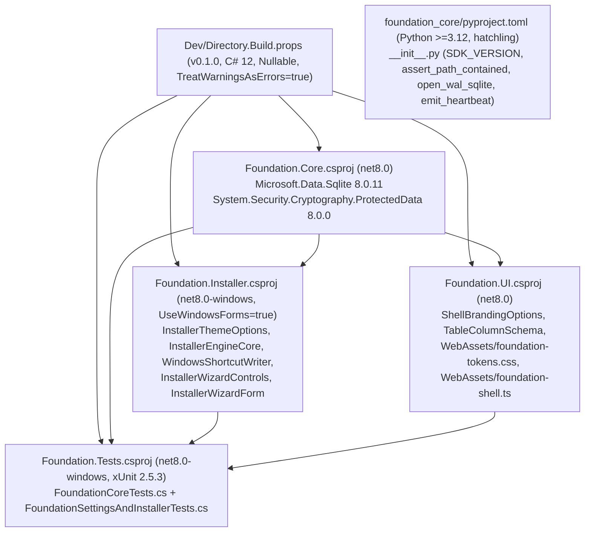

# Foundation — Deep Architecture, `.dll` Dependency Graph & Symbol Map (`ARCHITECTURE.md`)

> **Active Baseline Version:** `v0.3.0` (Introducing `Foundation.UI v0.2.0` / `@foundation/ui v0.2.0` ShadowLibrary Strict Standard Docked Terminal Drawer, Dual-Target Vanilla ES Module `foundation-terminal.js` + `foundation-terminal.css`, and `sync_foundation_sdk.py` Auto-Sync Pipeline) | **Full SemVer (`MAJOR.MINOR.PATCH`)** | **Owner:** `@devv` & `@pland` | **Clarity Editor:** `@tessa` ("The Manual Maker") | **Verified By:** `@dean` ([Standard 16 §3.5](file:///<PROJECTS_ROOT>/_DevBible/16_PROJECT_DOSSIERS_AND_FEATURE_TRACKING.md))

This technical manual documents the internal architecture, dependency topology, end-to-end execution pipelines, symbol lookup registry, storage/settings ownership, resilience engineering, security model, testing matrix, architectural decision records (ADRs), and zero-touch extension playbooks for **`Foundation`** (`<PROJECTS_ROOT>\Foundation\`), the version-pinned multi-language shared SDK powering the Mother Suite (`Mother`, `Housekeeping`, `ShadowLibrary`, `Redroom`, `Greenroom`, `StreamEngine`, `uStation`), standalone tools, and games.

---

## 1. System Context & Runtime Model

> [!IMPORTANT]

```mermaid
flowchart TB
    subgraph SharedLibs ["Canonical Shared Artifact Repository (<PROJECTS_ROOT>/SharedLibs/Foundation/v0.1.0)"]
        FCore["Foundation.Core.dll (.NET 8.0)"]
        FInst["Foundation.Installer.dll (.NET 8.0-windows WinForms)"]
        FUI["Foundation.UI.dll + WebAssets (CSS Tokens & TS Shell)"]
        FPy["foundation_core (Python 3.12+ Wheel)"]
    end

    subgraph HostProcess ["Consuming Host Process (Mother :5100, Housekeeping :5178, ShadowLibrary :5179, uStation :8460)"]
        Startup["Process Startup & CLI Resolver (SandboxEnvironment)"]
        ModLoader["In-Process & Plugin Slice Loader (HybridModuleLoader)"]
        SettingsMgr["Atomic Config & DPAPI Store (GranularSettingsManager + DpapiSecretStore)"]
        DbPool["SQLite WAL Connection Pool (SqliteWalPool)"]
        LockMgr["Cross-App Directory Lock Engine (PidSafeLockfile)"]
        JobSup["Dual-Token Queue & Win32 Job Object (DualJobCancellationCoordinator + JobObjectGuard)"]
        NetEngine["6-Pillar Resumable HTTP Engine (SafeNetworkTransfer)"]
        CrashHook["Global Exception & 15s Telemetry (CrashBundleService + HeartbeatLogger)"]
    end

    subgraph SetupProcess ["Host Setup / Uninstall Wizard (<AppName>-Setup-v<Ver>.exe)"]
        WizForm["Single-Surface Dark WinForms Wizard (InstallerWizardForm 650x434 -> 650x544)"]
        InstCore["Clean-Root Zip Extractor & Upgrade Guard (InstallerEngineCore)"]
        LnkWriter["Pure-C# MS-SHLLINK & HKCU Registry Writer (WindowsShortcutWriter)"]
    end

    subgraph PythonHost ["Python Sister Daemons (Greenroom :8420, Redroom :5180, StreamEngine :8430)"]
        PyGuard["Sandbox & SQLite WAL Helpers (assert_path_contained, open_wal_sqlite, emit_heartbeat)"]
    end

    FCore --> Startup
    FCore --> ModLoader
    FCore --> SettingsMgr
    FCore --> DbPool
    FCore --> LockMgr
    FCore --> JobSup
    FCore --> NetEngine
    FCore --> CrashHook
    FInst --> WizForm
    FInst --> InstCore
    FInst --> LnkWriter
    FUI --> HostProcess
    FPy --> PyGuard
```

> **Zero-Daemon Shared Library Archetype ([Standard 08 §8](file:///<PROJECTS_ROOT>/_DevBible/08_APPLICATION_ARCHETYPES_AND_LIFECYCLE.md), [Standard 17 §1.6](file:///<PROJECTS_ROOT>/_DevBible/17_SISTER_COMPATIBILITY_AND_FEATURE_PARITY.md))**
> `Foundation` is not a standalone background daemon and binds zero network ports of its own. Instead, it compiles into immutable, version-stamped assemblies (`Foundation.Core.dll`, `Foundation.Installer.dll`, `Foundation.UI.dll`), a Python 3.12+ wheel (`foundation_core`), and Web ES Module assets (`foundation-shell.ts`, `foundation-tokens.css`) published to [`<PROJECTS_ROOT>\SharedLibs\Foundation\v0.1.0\`](file:///<PROJECTS_ROOT>/SharedLibs/Foundation/v0.1.0/). Consuming applications copy and pin their target `Foundation` version into their own `Dev\lib\` directory, executing `Foundation` primitives in-process within the host application's threads, Kestrel/FastAPI workers, WinForms setup wizards, and WebView2 shells.

### Runtime Threading, Synchronization & Handle Model
- **In-Process Execution:** All `Foundation.Core` primitives execute on the caller's thread or async `Task` pool (`ConfigureAwait(false)` on all async I/O in [`SqliteWalPool.cs`](file:///<PROJECTS_ROOT>/Foundation/Dev/src/Foundation.Core/SqliteWalPool.cs#L55-L61) and [`SafeNetworkTransfer.cs`](file:///<PROJECTS_ROOT>/Foundation/Dev/src/Foundation.Core/SafeNetworkTransfer.cs#L108-L143) to prevent WinForms/UI synchronization-context deadlocks).
- **Thread-Safe Synchronization Primitives:**
  - [`HeartbeatLogger`](file:///<PROJECTS_ROOT>/Foundation/Dev/src/Foundation.Core/HeartbeatLogger.cs#L37-L110) synchronizes progress emissions and ANSI `\r\x1b[K` terminal writes via a dedicated private `lock (_sync)` monitor.
  - [`DualJobCancellationCoordinator`](file:///<PROJECTS_ROOT>/Foundation/Dev/src/Foundation.Core/JobObjectGuard.cs#L18-L91) guards `CancellationTokenSource` rotation (`_allJobsCts`, `_currentJobCts`, `_linkedCurrentCts`) under `lock (_sync)` so `StopCurrentJob()` and `StopAllJobs()` can be invoked safely from HTTP controller threads while background workers are executing.
  - [`DpapiSecretStore`](file:///<PROJECTS_ROOT>/Foundation/Dev/src/Foundation.Core/DpapiSecretStore.cs#L24-L93) serializes read-modify-write DPAPI encryption cycles via `lock (_sync)` and atomic `.tmp` $\rightarrow$ `File.Move(..., overwrite: true)` swaps.
- **OS Kernel Handles:** [`JobObjectGuard`](file:///<PROJECTS_ROOT>/Foundation/Dev/src/Foundation.Core/JobObjectGuard.cs#L120-L227) P/Invokes `kernel32.dll` (`CreateJobObject`, `SetInformationJobObject`, `AssignProcessToJobObject`, `CloseHandle`) with `JOB_OBJECT_LIMIT_KILL_ON_JOB_CLOSE` (`0x00002000`), ensuring any attached child tool (`7z.exe`, `chdman.exe`, `ffmpeg.exe`, `rclone.exe`) is terminated immediately by the Windows kernel if the host process exits or crashes.

---

## 2. Project & Module Dependency Graph

### Assembly & Package Dependency Rules

| Package / Assembly | Target Framework | Allowed Upstream Dependencies | Forbidden Dependencies (Enforced by `@dean`) |
| :--- | :--- | :--- | :--- |
| **[`Foundation.Core.dll`](file:///<PROJECTS_ROOT>/Foundation/Dev/src/Foundation.Core/Foundation.Core.csproj#L1-L13)** | `net8.0` | `.NET 8 BCL`, `Microsoft.Data.Sqlite` (`8.0.11`), `System.Security.Cryptography.ProtectedData` (`8.0.0`) | Zero UI frameworks (`System.Windows.Forms`, `WPF`, `Avalonia`), zero web frameworks (`Kestrel`), zero app-specific domain types. |
| **[`Foundation.Installer.dll`](file:///<PROJECTS_ROOT>/Foundation/Dev/src/Foundation.Installer/Foundation.Installer.csproj#L1-L13)** | `net8.0-windows` (`UseWindowsForms=true`) | `Foundation.Core.dll`, `System.Windows.Forms`, `System.Drawing`, `Microsoft.Win32` | Zero third-party COM/WScript shell dependencies, zero MSI/Inno external binaries, zero web server libraries. |
| **[`Foundation.UI.dll`](file:///<PROJECTS_ROOT>/Foundation/Dev/src/Foundation.UI/Foundation.UI.csproj#L1-L19)** | `net8.0` + ES Modules / CSS3 | `Foundation.Core.dll`, browser DOM APIs | Zero WinForms/WPF desktop coupling, zero app-specific business logic. |
| **[`foundation_core`](file:///<PROJECTS_ROOT>/Foundation/Dev/src/foundation_core/pyproject.toml#L1-L13)** | `Python >= 3.12` | Python standard library (`os`, `sys`, `time`, `pathlib`, `sqlite3`) | Zero heavy third-party packages (`fastapi`, `pydantic`, `sqlalchemy`) in core wheel. |
| **[`Foundation.Tests.dll`](file:///<PROJECTS_ROOT>/Foundation/Dev/tests/Foundation.Tests/Foundation.Tests.csproj#L1-L20)** | `net8.0-windows` | `Foundation.Core`, `Foundation.Installer`, `Foundation.UI`, `xunit` (`2.5.3`), `Microsoft.NET.Test.Sdk` (`17.8.0`) | Zero live `<PROGRAMS_ROOT>\...` mutations or external internet requests during test runs. |

---

## 3. End-to-End Data Flow per Pipeline

### Pipeline A: Fail-Closed Sandbox Boot, Module Discovery & Granular Settings Self-Healing
1. **CLI & Environment Resolution:** Host `Program.Main(string[] args)` instantiates [`new SandboxEnvironment(appId, args)`](file:///<PROJECTS_ROOT>/Foundation/Dev/src/Foundation.Core/SandboxEnvironment.cs#L43-L128). It inspects CLI flags (`--data-dir`, `--config`, `--log-dir`, `--port`, `--test-mode`, `--dry-run`, `--headless`, `--tray-only`, `--managed-by-mother`, `--suite-tab`, `--window`, `--browser`) and `<APP_ID>_*` environment variables, computing [`PresentationMode`](file:///<PROJECTS_ROOT>/Foundation/Dev/src/Foundation.Core/SandboxEnvironment.cs#L73-L92) and setting [`IsContainedSandbox = true`](file:///<PROJECTS_ROOT>/Foundation/Dev/src/Foundation.Core/SandboxEnvironment.cs#L100) whenever `--test-mode` or a custom data directory is active.
2. **Global Crash Hook Registration:** Host calls [`CrashBundleService.RegisterGlobalHandlers(env.LogDirectory, env.AppId, version, recentLogsProvider, activeJobsProvider)`](file:///<PROJECTS_ROOT>/Foundation/Dev/src/Foundation.Core/CrashBundleService.cs#L78-L110), wiring `AppDomain.CurrentDomain.UnhandledException` and `TaskScheduler.UnobservedTaskException` to [`CrashBundleService.WriteCrashBundle`](file:///<PROJECTS_ROOT>/Foundation/Dev/src/Foundation.Core/CrashBundleService.cs#L112-L167).
3. **Granular Settings Load & Corrupt-JSON Self-Healing:** Host constructs [`new GranularSettingsManager(env.DataDirectory)`](file:///<PROJECTS_ROOT>/Foundation/Dev/src/Foundation.Core/GranularSettingsManager.cs#L44-L52) and calls [`LoadOrSelfHeal<T>("settings.json", defaultFactory)`](file:///<PROJECTS_ROOT>/Foundation/Dev/src/Foundation.Core/GranularSettingsManager.cs#L60-L122). If `data\settings.json` is malformed or truncated, [`TryRestoreFromBackup`](file:///<PROJECTS_ROOT>/Foundation/Dev/src/Foundation.Core/GranularSettingsManager.cs#L229-L256) automatically deserializes `data\settings.json.bak`, copies it back over `settings.json`, and returns a [`SettingsLoadOutcome<T>`](file:///<PROJECTS_ROOT>/Foundation/Dev/src/Foundation.Core/GranularSettingsManager.cs#L16-L22) with `HealedFromBackup = true`.
4. **Hybrid Module Discovery:** Host creates [`new HybridModuleLoader()`](file:///<PROJECTS_ROOT>/Foundation/Dev/src/Foundation.Core/HybridModuleLoader.cs#L29-L37), invokes [`DiscoverFromAssemblies(assemblies)`](file:///<PROJECTS_ROOT>/Foundation/Dev/src/Foundation.Core/HybridModuleLoader.cs#L55-L68) for in-assembly `ModuleType.FolderSlice` slices and [`DiscoverExternalDllModules(modulesDir)`](file:///<PROJECTS_ROOT>/Foundation/Dev/src/Foundation.Core/HybridModuleLoader.cs#L70-L96) for `app\modules\*.Module.*.dll` plugins, and aggregates all module [`SchemaSettingDescriptor`](file:///<PROJECTS_ROOT>/Foundation/Dev/src/Foundation.Core/IFoundationModule.cs#L20-L31) records via [`GetAggregatedSettingsSchema()`](file:///<PROJECTS_ROOT>/Foundation/Dev/src/Foundation.Core/HybridModuleLoader.cs#L107-L118).

### Pipeline B: 6-Pillar Resumable Network Transfer & Streaming Hash Verification
1. **Disk Free-Space Pre-Flight Guard:** Caller invokes [`SafeNetworkTransfer.DownloadFileAsync(sourceUri, destinationFilePath, options)`](file:///<PROJECTS_ROOT>/Foundation/Dev/src/Foundation.Core/SafeNetworkTransfer.cs#L72-L151). Before opening a socket, [`AssertSufficientDiskSpace`](file:///<PROJECTS_ROOT>/Foundation/Dev/src/Foundation.Core/SafeNetworkTransfer.cs#L52-L70) verifies `DriveInfo.AvailableFreeSpace >= Math.Ceiling(expectedBytes * 1.2) + 512 MB`.
2. **HTTP Range Resume & Timeout Setup:** [`CreateHttpClient`](file:///<PROJECTS_ROOT>/Foundation/Dev/src/Foundation.Core/SafeNetworkTransfer.cs#L233-L241) configures `SocketsHttpHandler.ConnectTimeout = 10s`. If `<dest>.partial_<jobId>` already exists on disk from an interrupted run, [`DownloadFileAsync`](file:///<PROJECTS_ROOT>/Foundation/Dev/src/Foundation.Core/SafeNetworkTransfer.cs#L104-L106) attaches `Range: bytes=<existingOffset>-`.
3. **Token-Bucket Throttled Streaming & Per-Read Stall Timeout:** [`StreamToPartialFileAsync`](file:///<PROJECTS_ROOT>/Foundation/Dev/src/Foundation.Core/SafeNetworkTransfer.cs#L162-L209) streams 64 KB chunks to `<dest>.partial_<jobId>` while wrapping each `netStream.ReadAsync` in a linked `CancellationTokenSource` armed with `opts.ReadStallTimeout` (`30s`). If `MaxBytesPerSecond > 0`, it paces 1-second windows via `Task.Delay`.
4. **Exponential Backoff with Full Jitter:** On transient HTTP `429` / `5xx`, `IOException`, or stall timeout, [`ComputeBackoffWithFullJitter`](file:///<PROJECTS_ROOT>/Foundation/Dev/src/Foundation.Core/SafeNetworkTransfer.cs#L246-L254) honors any server `Retry-After` header (capped at `15s`) or sleeps `Random(50ms .. min(4000ms, 250ms * 2^attempt))` up to `MaxRetries = 3`.
5. **Streaming Dual-Hash Commit:** [`ComputeHashesAsync`](file:///<PROJECTS_ROOT>/Foundation/Dev/src/Foundation.Core/SafeNetworkTransfer.cs#L211-L231) computes both `SHA-256` and `SHA-1` incrementally in a single pass. [`VerifyExpectedHash`](file:///<PROJECTS_ROOT>/Foundation/Dev/src/Foundation.Core/SafeNetworkTransfer.cs#L153-L160) deletes the partial file and throws `InvalidDataException` on mismatch; on match, `File.Move(partialPath, fullDest, overwrite: true)` commits the final file atomically.

### Pipeline C: Clean-Root Setup Wizard, Upgrade Data Preservation & Mother Suite Registration
1. **Wizard Initialization & Mode Detection:** The host installer entry point creates [`InstallerThemeOptions`](file:///<PROJECTS_ROOT>/Foundation/Dev/src/Foundation.Installer/InstallerThemeOptions.cs#L25-L68), [`SandboxEnvironment`](file:///<PROJECTS_ROOT>/Foundation/Dev/src/Foundation.Core/SandboxEnvironment.cs#L26-L42), and [`InstallerEngineCore`](file:///<PROJECTS_ROOT>/Foundation/Dev/src/Foundation.Installer/InstallerEngineCore.cs#L46-L62), then launches [`InstallerWizardForm`](file:///<PROJECTS_ROOT>/Foundation/Dev/src/Foundation.Installer/InstallerWizardForm.cs#L20-L187) at `650×434` (`CollapsedClientHeight`). [`RefreshDetectionState()`](file:///<PROJECTS_ROOT>/Foundation/Dev/src/Foundation.Installer/InstallerWizardForm.cs#L210-L216) calls [`HasExistingInstallation`](file:///<PROJECTS_ROOT>/Foundation/Dev/src/Foundation.Installer/InstallerEngineCore.cs#L77-L85) to toggle the header badge between `CLEAN INSTALL`, `UPGRADE DETECTED` (`#10B981` Emerald), and `UNINSTALL MODE` (`#EF4444` Danger).
2. **Pre-Upgrade Code Purge Preserving User Data:** When [`InstallOrUpgradeFromZipAsync`](file:///<PROJECTS_ROOT>/Foundation/Dev/src/Foundation.Installer/InstallerEngineCore.cs#L114-L197) runs, [`CleanPreviousAppCodePreservingData`](file:///<PROJECTS_ROOT>/Foundation/Dev/src/Foundation.Installer/InstallerEngineCore.cs#L248-L258) deletes only `app\` and `scripts\` while [`ProtectedTopDirectories`](file:///<PROJECTS_ROOT>/Foundation/Dev/src/Foundation.Installer/InstallerEngineCore.cs#L50-L53) (`data`, `logs`, `backups`, `drops`, `saves_vault`, `_Quarantine`, `registry`) are strictly preserved.
3. **Bounded Extraction & Manifest Commit:** Each ZIP entry is validated via [`SandboxEnvironment.AssertPathContained`](file:///<PROJECTS_ROOT>/Foundation/Dev/src/Foundation.Installer/InstallerEngineCore.cs#L151) (blocking Zip-Slip path traversal) and enforced against [`MaxExpandedPayloadBytes = 2 GB`](file:///<PROJECTS_ROOT>/Foundation/Dev/src/Foundation.Installer/InstallerEngineCore.cs#L48) (blocking Zip bombs). After extraction, [`FoundationInstallManifest`](file:///<PROJECTS_ROOT>/Foundation/Dev/src/Foundation.Installer/InstallerEngineCore.cs#L21-L31) is written to `app\install-manifest.json`, and [`RegisterSuiteManifestIfPresent`](file:///<PROJECTS_ROOT>/Foundation/Dev/src/Foundation.Installer/InstallerEngineCore.cs#L260-L275) copies `app\suite.manifest.json` to `<PROGRAMS_ROOT>\Mother\manifests\<appId>.manifest.json` (or `Sandbox\data\Mother\manifests\` in `--test-mode`).
4. **Shortcuts & Registry Isolation:** [`WindowsShortcutWriter.WriteShortcut`](file:///<PROJECTS_ROOT>/Foundation/Dev/src/Foundation.Installer/WindowsShortcutWriter.cs#L34-L78) writes pure-C# `[MS-SHLLINK]` `.lnk` binaries (`0x0000004C` header + `00021401-0000-0000-C000-000000000046` CLSID), while [`RegisterCurrentUserUninstallEntry`](file:///<PROJECTS_ROOT>/Foundation/Dev/src/Foundation.Installer/WindowsShortcutWriter.cs#L159-L186) immediately no-ops whenever `isContainedSandbox == true`.

---

## 4. Complete File & Symbol Lookup Registry (`<= 400 LOC` Hard Gate)

Every source, script, configuration, and test file in `<PROJECTS_ROOT>\Foundation\Dev\` is cataloged below with its exact line count and `<= 400 LOC` compliance status:

| File Path (Relative to `Dev\`) | Exact LOC | `<= 400 LOC` Status | Primary Exported Symbols | Role & Responsibility |
| :--- | :---: | :---: | :--- | :--- |
| [`Directory.Build.props`](file:///<PROJECTS_ROOT>/Foundation/Dev/Directory.Build.props#L1-L24) | `24` | ✅ `PASS` | MSBuild Global Properties | Enforces `LangVersion=12.0`, `Nullable=enable`, `TreatWarningsAsErrors=true`, `Deterministic=true`, `Version=0.1.0`, and strips `.pdb` in `Release`. |
| [`Foundation.sln`](file:///<PROJECTS_ROOT>/Foundation/Dev/Foundation.sln#L1-L36) | `36` | ✅ `PASS` | Visual Studio Solution | Binds `Foundation.Core`, `Foundation.Installer`, `Foundation.UI`, and `Foundation.Tests`. |
| [`src/Foundation.Core/Foundation.Core.csproj`](file:///<PROJECTS_ROOT>/Foundation/Dev/src/Foundation.Core/Foundation.Core.csproj#L1-L13) | `13` | ✅ `PASS` | `Foundation.Core` Assembly | Targets `net8.0`; references `Microsoft.Data.Sqlite` (`8.0.11`) and `ProtectedData` (`8.0.0`). |
| [`src/Foundation.Core/IFoundationModule.cs`](file:///<PROJECTS_ROOT>/Foundation/Dev/src/Foundation.Core/IFoundationModule.cs#L1-L57) | `57` | ✅ `PASS` | [`ModuleType`](file:///<PROJECTS_ROOT>/Foundation/Dev/src/Foundation.Core/IFoundationModule.cs#L11-L15), [`SchemaSettingDescriptor`](file:///<PROJECTS_ROOT>/Foundation/Dev/src/Foundation.Core/IFoundationModule.cs#L20-L31), [`IFoundationModule`](file:///<PROJECTS_ROOT>/Foundation/Dev/src/Foundation.Core/IFoundationModule.cs#L37-L57) | Unified contract for in-assembly `FolderSlice` modules and external `DllModule` plugins + declarative settings schema. |
| [`src/Foundation.Core/SandboxEnvironment.cs`](file:///<PROJECTS_ROOT>/Foundation/Dev/src/Foundation.Core/SandboxEnvironment.cs#L1-L243) | `243` | ✅ `PASS` | [`UiPresentationMode`](file:///<PROJECTS_ROOT>/Foundation/Dev/src/Foundation.Core/SandboxEnvironment.cs#L15-L21), [`SandboxEnvironment`](file:///<PROJECTS_ROOT>/Foundation/Dev/src/Foundation.Core/SandboxEnvironment.cs#L26-L243) | Resolves CLI flags/env vars, 4 UI presentation modes, `\\?\` long paths, and fail-closed `AssertPathContained`. |
| [`src/Foundation.Core/CrashBundleService.cs`](file:///<PROJECTS_ROOT>/Foundation/Dev/src/Foundation.Core/CrashBundleService.cs#L1-L197) | `197` | ✅ `PASS` | [`CrashBundlePayload`](file:///<PROJECTS_ROOT>/Foundation/Dev/src/Foundation.Core/CrashBundleService.cs#L22-L65), [`CrashBundleService`](file:///<PROJECTS_ROOT>/Foundation/Dev/src/Foundation.Core/CrashBundleService.cs#L70-L197) | Global unhandled exception hooks and self-contained JSON crash bundle writer (`logs\crashes\`). |
| [`src/Foundation.Core/SqliteWalPool.cs`](file:///<PROJECTS_ROOT>/Foundation/Dev/src/Foundation.Core/SqliteWalPool.cs#L1-L115) | `115` | ✅ `PASS` | [`SqliteWalPool`](file:///<PROJECTS_ROOT>/Foundation/Dev/src/Foundation.Core/SqliteWalPool.cs#L18-L115) | SQLite `WAL` connection factory (`busy_timeout=5000`, `synchronous=NORMAL`, `foreign_keys=ON`) and atomic `VacuumIntoAsync`. |
| [`src/Foundation.Core/PidSafeLockfile.cs`](file:///<PROJECTS_ROOT>/Foundation/Dev/src/Foundation.Core/PidSafeLockfile.cs#L1-L266) | `266` | ✅ `PASS` | [`PidSafeLockEnvelope`](file:///<PROJECTS_ROOT>/Foundation/Dev/src/Foundation.Core/PidSafeLockfile.cs#L18-L46), [`PidSafeLockfile`](file:///<PROJECTS_ROOT>/Foundation/Dev/src/Foundation.Core/PidSafeLockfile.cs#L52-L266) | Standard 19 §4 JSON lockfile manager verifying `(pid, processStartTimeUtc)` and breaking dead orphan locks. |
| [`src/Foundation.Core/ToolResolver.cs`](file:///<PROJECTS_ROOT>/Foundation/Dev/src/Foundation.Core/ToolResolver.cs#L1-L162) | `162` | ✅ `PASS` | [`ToolResolutionSource`](file:///<PROJECTS_ROOT>/Foundation/Dev/src/Foundation.Core/ToolResolver.cs#L12-L18), [`ToolResolutionResult`](file:///<PROJECTS_ROOT>/Foundation/Dev/src/Foundation.Core/ToolResolver.cs#L20-L26), [`ToolResolver`](file:///<PROJECTS_ROOT>/Foundation/Dev/src/Foundation.Core/ToolResolver.cs#L35-L162) | 4-tier external binary resolver (`ExplicitOverride` $\rightarrow$ `BundledAppTools` $\rightarrow$ `SystemPath` $\rightarrow$ `MissingFallback`). |
| [`src/Foundation.Core/HeartbeatLogger.cs`](file:///<PROJECTS_ROOT>/Foundation/Dev/src/Foundation.Core/HeartbeatLogger.cs#L1-L124) | `124` | ✅ `PASS` | [`HeartbeatSnapshot`](file:///<PROJECTS_ROOT>/Foundation/Dev/src/Foundation.Core/HeartbeatLogger.cs#L12-L20), [`HeartbeatLogger`](file:///<PROJECTS_ROOT>/Foundation/Dev/src/Foundation.Core/HeartbeatLogger.cs#L26-L124) | Enforces `<= 15s` `[HEARTBEAT]` emissions and TTY-aware `\r\x1b[K` in-place console line updates. |
| [`src/Foundation.Core/JobObjectGuard.cs`](file:///<PROJECTS_ROOT>/Foundation/Dev/src/Foundation.Core/JobObjectGuard.cs#L1-L228) | `228` | ✅ `PASS` | [`DualJobCancellationCoordinator`](file:///<PROJECTS_ROOT>/Foundation/Dev/src/Foundation.Core/JobObjectGuard.cs#L18-L114), [`JobObjectGuard`](file:///<PROJECTS_ROOT>/Foundation/Dev/src/Foundation.Core/JobObjectGuard.cs#L120-L228) | Dual-scope job cancellation (`StopCurrentJob` vs `StopAllJobs`) and Win32 `JOB_OBJECT_LIMIT_KILL_ON_JOB_CLOSE` guard. |
| [`src/Foundation.Core/SafeNetworkTransfer.cs`](file:///<PROJECTS_ROOT>/Foundation/Dev/src/Foundation.Core/SafeNetworkTransfer.cs#L1-L255) | `255` | ✅ `PASS` | [`SafeTransferOptions`](file:///<PROJECTS_ROOT>/Foundation/Dev/src/Foundation.Core/SafeNetworkTransfer.cs#L18-L30), [`SafeTransferResult`](file:///<PROJECTS_ROOT>/Foundation/Dev/src/Foundation.Core/SafeNetworkTransfer.cs#L32-L39), [`SafeNetworkTransfer`](file:///<PROJECTS_ROOT>/Foundation/Dev/src/Foundation.Core/SafeNetworkTransfer.cs#L50-L255) | Standard 19 §5 6-Pillar network transfer engine (timeouts, jitter backoff, HTTP `Range`, disk preflight, throttle, dual hash). |
| [`src/Foundation.Core/HybridModuleLoader.cs`](file:///<PROJECTS_ROOT>/Foundation/Dev/src/Foundation.Core/HybridModuleLoader.cs#L1-L166) | `166` | ✅ `PASS` | [`DiscoveredModuleRecord`](file:///<PROJECTS_ROOT>/Foundation/Dev/src/Foundation.Core/HybridModuleLoader.cs#L15-L23), [`HybridModuleLoader`](file:///<PROJECTS_ROOT>/Foundation/Dev/src/Foundation.Core/HybridModuleLoader.cs#L29-L166) | Runtime reflection loader for in-assembly `FolderSlice` modules and external `app\modules\*.dll` plugins. |
| [`src/Foundation.Core/GranularSettingsManager.cs`](file:///<PROJECTS_ROOT>/Foundation/Dev/src/Foundation.Core/GranularSettingsManager.cs#L1-L257) | `257` | ✅ `PASS` | [`SettingsLoadOutcome<T>`](file:///<PROJECTS_ROOT>/Foundation/Dev/src/Foundation.Core/GranularSettingsManager.cs#L16-L22), [`GranularSettingsManager`](file:///<PROJECTS_ROOT>/Foundation/Dev/src/Foundation.Core/GranularSettingsManager.cs#L28-L257) | Atomic `.tmp` $\rightarrow$ `.bak` JSON settings persistence, `.bak` corrupt self-healing, and 20-snapshot `data\config_history\` rotation. |
| [`src/Foundation.Core/DpapiSecretStore.cs`](file:///<PROJECTS_ROOT>/Foundation/Dev/src/Foundation.Core/DpapiSecretStore.cs#L1-L161) | `161` | ✅ `PASS` | [`DpapiSecretStore`](file:///<PROJECTS_ROOT>/Foundation/Dev/src/Foundation.Core/DpapiSecretStore.cs#L19-L161) | Windows DPAPI (`DataProtectionScope.CurrentUser`) encrypted key-value store persisted at `data\secrets.dpapi`. |
| [`src/Foundation.Installer/Foundation.Installer.csproj`](file:///<PROJECTS_ROOT>/Foundation/Dev/src/Foundation.Installer/Foundation.Installer.csproj#L1-L18) | `18` | ✅ `PASS` | `Foundation.Installer` Assembly (`v0.2.1`) | Targets `net8.0-windows` (`UseWindowsForms=true`); references `Foundation.Core`. |
| [`src/Foundation.Installer/InstallerThemeOptions.cs`](file:///<PROJECTS_ROOT>/Foundation/Dev/src/Foundation.Installer/InstallerThemeOptions.cs#L1-L68) | `68` | ✅ `PASS` | [`InstallerCustomToggle`](file:///<PROJECTS_ROOT>/Foundation/Dev/src/Foundation.Installer/InstallerThemeOptions.cs#L14-L19), [`InstallerThemeOptions`](file:///<PROJECTS_ROOT>/Foundation/Dev/src/Foundation.Installer/InstallerThemeOptions.cs#L25-L68) | Per-app visual branding, accent color, icon resources, default install directory, and custom checkbox options. |
| [`src/Foundation.Installer/InstallerEngineCore.cs`](file:///<PROJECTS_ROOT>/Foundation/Dev/src/Foundation.Installer/InstallerEngineCore.cs#L1-L276) | `276` | ✅ `PASS` | [`FoundationInstallManifest`](file:///<PROJECTS_ROOT>/Foundation/Dev/src/Foundation.Installer/InstallerEngineCore.cs#L21-L31), [`FoundationInstallResult`](file:///<PROJECTS_ROOT>/Foundation/Dev/src/Foundation.Installer/InstallerEngineCore.cs#L33-L40), [`InstallerEngineCore`](file:///<PROJECTS_ROOT>/Foundation/Dev/src/Foundation.Installer/InstallerEngineCore.cs#L46-L276) | Clean-root ZIP extraction, 2 GB Zip-bomb guard, upgrade `data\`/`logs\` preservation, `Mother` manifest registration, and verification. |
| [`src/Foundation.Installer/InstallerEngine.Core.cs`](file:///<PROJECTS_ROOT>/Foundation/Dev/src/Foundation.Installer/InstallerEngine.Core.cs#L1-L316) | `316` | ✅ `PASS` | `InstallerAppDescriptor`, `InstallerConfigOverride`, `InstallManifest`, `InstallerOperationResult`, `InstallerSandboxContext`, `InstallerEngine` | Parameterized 4-pillar installer descriptor, sandbox context, config override loader, and default target path resolver (`v0.2.1`). |
| [`src/Foundation.Installer/InstallerEngine.InstallAndExtract.cs`](file:///<PROJECTS_ROOT>/Foundation/Dev/src/Foundation.Installer/InstallerEngine.InstallAndExtract.cs#L1-L237) | `237` | ✅ `PASS` | `InstallerEngine.InstallAsync` | Atomic payload extraction, protected user state preservation, pre-upgrade backup, and install manifest persistence (`v0.2.1`). |
| [`src/Foundation.Installer/InstallerEngine.TestModeAndCli.cs`](file:///<PROJECTS_ROOT>/Foundation/Dev/src/Foundation.Installer/InstallerEngine.TestModeAndCli.cs#L1-L163) | `163` | ✅ `PASS` | `InstallerEngine` (registry, backup, payload stream, containment) | HKCU/sandbox uninstall registration, pre-upgrade state backups, running process shutdown, and embedded payload stream loader (`v0.2.1`). |
| [`src/Foundation.Installer/InstallerEngine.UninstallAndShortcuts.cs`](file:///<PROJECTS_ROOT>/Foundation/Dev/src/Foundation.Installer/InstallerEngine.UninstallAndShortcuts.cs#L1-L256) | `256` | ✅ `PASS` | `InstallerEngine.UninstallAsync` | Clean uninstallation and Windows Desktop/Start Menu/Startup `.lnk` shortcut generation (`v0.2.1`). |
| [`src/Foundation.Installer/InstallerEngine.VerifyAndUpgrade.cs`](file:///<PROJECTS_ROOT>/Foundation/Dev/src/Foundation.Installer/InstallerEngine.VerifyAndUpgrade.cs#L1-L75) | `75` | ✅ `PASS` | `InstallerEngine.VerifyPayloadAsync` | Embedded payload SHA-256 and ZIP central-directory verification (`v0.2.1`). |
| [`src/Foundation.Installer/StandardInstallerHost.cs`](file:///<PROJECTS_ROOT>/Foundation/Dev/src/Foundation.Installer/StandardInstallerHost.cs#L1-L286) | `286` | ✅ `PASS` | `StandardInstallerHost` (`Run`) | Turnkey single-call 4-Pillar Setup & Uninstall CLI/GUI entry point (`v0.2.1`). |
| [`src/Foundation.Installer/WindowsShortcutWriter.cs`](file:///<PROJECTS_ROOT>/Foundation/Dev/src/Foundation.Installer/WindowsShortcutWriter.cs#L1-L216) | `216` | ✅ `PASS` | [`WindowsShortcutWriter`](file:///<PROJECTS_ROOT>/Foundation/Dev/src/Foundation.Installer/WindowsShortcutWriter.cs#L18-L216) | Pure managed C# `[MS-SHLLINK]` `.lnk` binary writer and sandbox-safe `HKCU\...\Uninstall` registry helper. |
| [`src/Foundation.Installer/InstallerWizardControls.cs`](file:///<PROJECTS_ROOT>/Foundation/Dev/src/Foundation.Installer/InstallerWizardControls.cs#L1-L105) | `105` | ✅ `PASS` | [`InstallerWizardControls`](file:///<PROJECTS_ROOT>/Foundation/Dev/src/Foundation.Installer/InstallerWizardControls.cs#L16-L105) | Deep Slate Dark WinForms control factories (`CreateDarkCheckBox`, `CreateFlatButton`, `CreateDarkLogTextBox`, `ParseHexColor`). |
| [`src/Foundation.Installer/InstallerWizardForm.cs`](file:///<PROJECTS_ROOT>/Foundation/Dev/src/Foundation.Installer/InstallerWizardForm.cs#L1-L299) | `299` | ✅ `PASS` | [`InstallerWizardForm`](file:///<PROJECTS_ROOT>/Foundation/Dev/src/Foundation.Installer/InstallerWizardForm.cs#L16-L299) | Reusable `650×434` (collapsed) / `650×544` (expanded) Deep Slate Dark Setup, Upgrade, and Uninstall WinForms Wizard shell (`v0.2.1`). |
| [`src/Foundation.Installer/InstallerWizardForm.LayoutAndTheme.cs`](file:///<PROJECTS_ROOT>/Foundation/Dev/src/Foundation.Installer/InstallerWizardForm.LayoutAndTheme.cs#L1-L303) | `303` | ✅ `PASS` | `InstallerWizardForm` (`InitializeOptionsAndFooterControls`, `UpdateLayoutBounds`, `SetDetailsExpanded`) | Options/footer control initialization, DWM dark title bar styling, and responsive layout bounds (`v0.2.1`). |
| [`src/Foundation.Installer/InstallerWizardForm.ExecutionAndLogs.cs`](file:///<PROJECTS_ROOT>/Foundation/Dev/src/Foundation.Installer/InstallerWizardForm.ExecutionAndLogs.cs#L1-L261) | `261` | ✅ `PASS` | `InstallerWizardForm` (`OnBrowseClicked`, `OnPrimaryActionClickedAsync`, `AppendLogLine`) | Upgrade badge detection, `FolderBrowserDialog` browse handler, async install/upgrade/uninstall execution, and log console (`v0.2.1`). |
| [`src/Foundation.UI/Foundation.UI.csproj`](file:///<PROJECTS_ROOT>/Foundation/Dev/src/Foundation.UI/Foundation.UI.csproj#L1-L19) | `19` | ✅ `PASS` | `Foundation.UI` Assembly | Targets `net8.0`; copies `WebAssets\**\*.*` to output and publish directories. |
| [`src/Foundation.UI/ShellBrandingOptions.cs`](file:///<PROJECTS_ROOT>/Foundation/Dev/src/Foundation.UI/ShellBrandingOptions.cs#L1-L51) | `51` | ✅ `PASS` | [`TableColumnSchema`](file:///<PROJECTS_ROOT>/Foundation/Dev/src/Foundation.UI/ShellBrandingOptions.cs#L14-L20), [`ShellBrandingOptions`](file:///<PROJECTS_ROOT>/Foundation/Dev/src/Foundation.UI/ShellBrandingOptions.cs#L26-L51) | Per-app UI shell branding options (`SdkVersion = "0.1.0"`, `BrandAccentHex`, sidebar/terminal defaults) and table column descriptors. |
| [`src/Foundation.UI/WebAssets/foundation-tokens.css`](file:///<PROJECTS_ROOT>/Foundation/Dev/src/Foundation.UI/WebAssets/foundation-tokens.css#L1-L117) | `117` | ✅ `PASS` | `:root`, `.app-shell`, `.sidebar-nav-rail`, `.docked-terminal-drawer`, `.foundation-tooltip` | Standard 09 Deep Slate CSS tokens, `220px`/`56px` collapsible sidebar rail, docked terminal sash, and 2-line tooltip styles. |
| [`src/Foundation.UI/WebAssets/foundation-shell.ts`](file:///<PROJECTS_ROOT>/Foundation/Dev/src/Foundation.UI/WebAssets/foundation-shell.ts#L1-L58) | `58` | ✅ `PASS` | `TerminalPreset`, `TerminalLayoutState`, `clampTerminalHeight`, `computeTerminalPresetHeight` | TypeScript interfaces and geometry/shortcut functions (`Ctrl+\``, `Ctrl+B`, `S`/`M`/`L` presets) for the shared web shell. |
| [`src/foundation_core/pyproject.toml`](file:///<PROJECTS_ROOT>/Foundation/Dev/src/foundation_core/pyproject.toml#L1-L13) | `13` | ✅ `PASS` | `foundation-core` (`0.1.0`) | Hatchling Python wheel build manifest (`requires-python = ">=3.12"`). |
| [`src/foundation_core/__init__.py`](file:///<PROJECTS_ROOT>/Foundation/Dev/src/foundation_core/__init__.py#L1-L47) | `47` | ✅ `PASS` | [`SDK_VERSION`](file:///<PROJECTS_ROOT>/Foundation/Dev/src/foundation_core/__init__.py#L14), [`assert_path_contained`](file:///<PROJECTS_ROOT>/Foundation/Dev/src/foundation_core/__init__.py#L17-L25), [`open_wal_sqlite`](file:///<PROJECTS_ROOT>/Foundation/Dev/src/foundation_core/__init__.py#L28-L37), [`emit_heartbeat`](file:///<PROJECTS_ROOT>/Foundation/Dev/src/foundation_core/__init__.py#L40-L47) | Python 3.12+ companion SDK enforcing fail-closed sandbox containment, SQLite WAL pragmas, and `<= 15s` heartbeats. |
| [`tests/Foundation.Tests/Foundation.Tests.csproj`](file:///<PROJECTS_ROOT>/Foundation/Dev/tests/Foundation.Tests/Foundation.Tests.csproj#L1-L20) | `20` | ✅ `PASS` | `Foundation.Tests` Suite | xUnit 2.5.3 test project targeting `net8.0-windows`. |
| [`tests/Foundation.Tests/FoundationCoreTests.cs`](file:///<PROJECTS_ROOT>/Foundation/Dev/tests/Foundation.Tests/FoundationCoreTests.cs#L1-L188) | `188` | ✅ `PASS` | [`SampleFolderSliceModule`](file:///<PROJECTS_ROOT>/Foundation/Dev/tests/Foundation.Tests/FoundationCoreTests.cs#L19-L33), [`FoundationCoreTests`](file:///<PROJECTS_ROOT>/Foundation/Dev/tests/Foundation.Tests/FoundationCoreTests.cs#L35-L188) | 5 unit tests verifying `SandboxEnvironment`, `PidSafeLockfile`, `SqliteWalPool`, `HybridModuleLoader`, `DualJobCancellationCoordinator`, `CrashBundleService`, and `HeartbeatLogger`. |
| [`tests/Foundation.Tests/FoundationSettingsAndInstallerTests.cs`](file:///<PROJECTS_ROOT>/Foundation/Dev/tests/Foundation.Tests/FoundationSettingsAndInstallerTests.cs#L1-L230) | `230` | ✅ `PASS` | [`SampleSettingsModel`](file:///<PROJECTS_ROOT>/Foundation/Dev/tests/Foundation.Tests/FoundationSettingsAndInstallerTests.cs#L21-L26), [`FoundationSettingsAndInstallerTests`](file:///<PROJECTS_ROOT>/Foundation/Dev/tests/Foundation.Tests/FoundationSettingsAndInstallerTests.cs#L28-L230) | 4 unit tests verifying `GranularSettingsManager`, `DpapiSecretStore`, `InstallerEngineCore`, `WindowsShortcutWriter`, `InstallerWizardForm`, `SafeNetworkTransfer`, and `ToolResolver`. |
| [`src/Foundation.Core/CliAndProcessPrimitives.cs`](file:///<PROJECTS_ROOT>/Foundation/Dev/src/Foundation.Core/CliAndProcessPrimitives.cs#L1-L212) | `212` | ✅ `PASS` | `CliSchema`, `ParsedCliArguments`, `BoundedTailStream`, `CappedSharedLogSink` | Shared CLI flag normalization, `64 KB` circular stdout/stderr tail ring buffer, and `4 MB` capped shared log sink. |
| [`src/Foundation.Retro/ConsoleSystemCatalog.cs`](file:///<PROJECTS_ROOT>/Foundation/Dev/src/Foundation.Retro/ConsoleSystemCatalog.cs#L1-L320) | `320` | ✅ `PASS` | `ConsoleSystemCatalog`, `RetroPlatformCatalogEntry`, `RetroBiosRequirement`, `RetroHeaderSkipRule`, `RetroProvenanceTagRule` | Authoritative 64-platform retro system catalog, 50+ BIOS definitions, copier header-skip rules, and provenance tag rules (`v0.1.0`). |
| [`src/Foundation.Retro/DatTitleNormalizer.cs`](file:///<PROJECTS_ROOT>/Foundation/Dev/src/Foundation.Retro/DatTitleNormalizer.cs#L1-L185) | `185` | ✅ `PASS` | `DatTitleNormalizer`, `ParsedRomFilenameMetadata` | Canonical ROM filename parser extracting region, language, revision, serial, provenance tags, and normalized 1G1R title keys (`v0.1.0`). |
| [`src/Foundation.Retro/NoIntroRedumpDatParser.cs`](file:///<PROJECTS_ROOT>/Foundation/Dev/src/Foundation.Retro/NoIntroRedumpDatParser.cs#L1-L355) | `355` | ✅ `PASS` | `NoIntroRedumpDatParser`, `ParsedDatCatalogHeader`, `ParsedDatRomRecord` | Streaming Logiqx/No-Intro/Redump/MAME/RetroAchievements XML, ClrMamePro text, and `.sfv`/`.md5` DAT parser (`v0.1.0`). |
| [`src/Foundation.Retro/HeaderlessRomStripper.cs`](file:///<PROJECTS_ROOT>/Foundation/Dev/src/Foundation.Retro/HeaderlessRomStripper.cs#L1-L180) | `180` | ✅ `PASS` | `HeaderlessRomStripper`, `MagicBytePlatformDetector` | Copier header skip-byte detector (`iNES` 16B, `fwNES`, `SMC`/`SWC` 512B, `A78` 128B, `LNX` 64B) and magic-byte platform detector (`v0.1.0`). |
| [`src/Foundation.Retro/SoftPatchEngine.cs`](file:///<PROJECTS_ROOT>/Foundation/Dev/src/Foundation.Retro/SoftPatchEngine.cs#L1-L265) | `265` | ✅ `PASS` | `SoftPatchEngine` | Pure in-memory `IPS`, `BPS1`, and `UPS1` binary ROM soft-patchers and patch generators (`v0.1.0`). |
| [`src/Foundation.Sidecars/SinglePassStreamHasher.cs`](file:///<PROJECTS_ROOT>/Foundation/Dev/src/Foundation.Sidecars/SinglePassStreamHasher.cs#L1-L195) | `195` | ✅ `PASS` | `SinglePassStreamHasher`, `ComputedStreamHashes`, `Crc32Accumulator` | Zero-allocation `ArrayPool<byte>.Shared` (`128 KB`) single-pass `CRC32`/`MD5`/`SHA-1`/`SHA-256` and headerless ROM stream hasher (`v0.1.0`). |
| [`src/Foundation.Sidecars/SevenZipAndZipInspector.cs`](file:///<PROJECTS_ROOT>/Foundation/Dev/src/Foundation.Sidecars/SevenZipAndZipInspector.cs#L1-L270) | `270` | ✅ `PASS` | `SevenZipAndZipInspector`, `InspectedArchiveItem` | `.zip` central-directory reader, `7z.exe l -slt` container inspector, single-entry extractor, and deterministic TorrentZip builder (`v0.1.0`). |
| [`src/Foundation.Sidecars/HashSidecarService.cs`](file:///<PROJECTS_ROOT>/Foundation/Dev/src/Foundation.Sidecars/HashSidecarService.cs#L1-L280) | `280` | ✅ `PASS` | `HashSidecarService`, `SidecarDocument`, `SidecarEntryItem`, `ArchiveCrcIndexEntry` | Standard 17 `.hash` v1 parser, serializer, wrapper-path normalizer, `COMPOSITE_SHA1` calculator, and archive `CRC32` index validator (`v0.1.0`). |
| [`src/Foundation.Sidecars/HkLockSentinel.cs`](file:///<PROJECTS_ROOT>/Foundation/Dev/src/Foundation.Sidecars/HkLockSentinel.cs#L1-L195) | `195` | ✅ `PASS` | `HkLockSentinel`, `SisterAppCoexistenceClient` | Cross-app `.<app>_<pid>.hklock` directory lock sentinel, `.partial_`/`.part` filter, and `<VaultRoot>\.coexistence.json` v2 peer prober (`v0.1.0`). |
| [`src/Foundation.Server/TieredAuthEngine.cs`](file:///<PROJECTS_ROOT>/Foundation/Dev/src/Foundation.Server/TieredAuthEngine.cs#L1-L265) | `265` | ✅ `PASS` | `TieredAuthEngine`, `TieredAuthConfigSnapshot`, `TieredAuthEvaluation` | 7-step Kestrel authorization engine (API Token, Tailscale Serve, Loopback, PBKDF2-SHA256, HMAC session cookie, Tailscale `100.64.0.0/10`) (`v0.1.0`). |
| [`src/Foundation.Server/TieredAuthMiddleware.cs`](file:///<PROJECTS_ROOT>/Foundation/Dev/src/Foundation.Server/TieredAuthMiddleware.cs#L1-L95) | `95` | ✅ `PASS` | `FoundationTieredAuthMiddleware` | Reusable ASP.NET Core middleware enforcing `TieredAuthEngine` across `/api/*`, `/hubs/*`, and `/mcp*` routes (`v0.1.0`). |
| [`src/Foundation.Server/SisterAppStandardEndpoints.cs`](file:///<PROJECTS_ROOT>/Foundation/Dev/src/Foundation.Server/SisterAppStandardEndpoints.cs#L1-L105) | `105` | ✅ `PASS` | `SisterAppStandardEndpoints` | Maps `/suite.manifest.json`, `/api/v1/suite/manifest`, and `/api/suite/manifest` (`v0.1.0`). |
| [`src/Foundation.Launcher/RootLauncherHost.cs`](file:///<PROJECTS_ROOT>/Foundation/Dev/src/Foundation.Launcher/RootLauncherHost.cs#L1-L102) | `102` | ✅ `PASS` | `RootLauncherHost` | Thin outer-root `.exe` launcher forwarder attaching parent console on CLI verbs and propagating exit codes (`v0.1.0`). |
| [`src/Foundation.UI/Desktop/StaNativeDialogBridgeBase.cs`](file:///<PROJECTS_ROOT>/Foundation/Dev/src/Foundation.UI/Desktop/StaNativeDialogBridgeBase.cs#L1-L150) | `150` | ✅ `PASS` | `StaNativeDialogBridgeBase` | Dedicated STA thread native WinForms `FolderBrowserDialog` / `OpenFileDialog` bridge (`v0.1.0`). |
| [`src/Foundation.UI/Desktop/DisposableWebViewHostForm.cs`](file:///<PROJECTS_ROOT>/Foundation/Dev/src/Foundation.UI/Desktop/DisposableWebViewHostForm.cs#L1-L115) | `115` | ✅ `PASS` | `DisposableWebViewHostForm` | `1440x920` dark-themed WebView2 desktop host window disposing browser subprocesses on close (`0 MB` idle RAM) (`v0.1.0`). |
| [`src/Foundation.UI/Desktop/TrayIconBadgeHelper.cs`](file:///<PROJECTS_ROOT>/Foundation/Dev/src/Foundation.UI/Desktop/TrayIconBadgeHelper.cs#L1-L92) | `92` | ✅ `PASS` | `TrayIconBadgeHelper` | GDI+ dynamic tray icon renderer with status badge overlay (`v0.1.0`). |
| [`src/Foundation.Installer/InstallerEngineCore.BackupAndVerify.cs`](file:///<PROJECTS_ROOT>/Foundation/Dev/src/Foundation.Installer/InstallerEngineCore.BackupAndVerify.cs#L1-L175) | `175` | ✅ `PASS` | `InstallerEngineCore.CreatePreUpgradeBackupAsync` | Fast `<1.5s` `NoCompression` pre-upgrade state backup skipping `data\_Quarantine\*`, `data\drops\*`, `data\webview2_cache\*`, and `data\backups\*`. |
| [`src/Foundation.UI/Web/index.ts`](file:///<PROJECTS_ROOT>/Foundation/Dev/src/Foundation.UI/Web/index.ts#L1-L52) | `52` | ✅ `PASS` | `@foundation/ui` (`v0.2.0`) | Barrel export for shared React 19 UI components (`StyledTooltip`, `ModalDialog`, `ConfirmActionModal`, `ResponsiveTable`, `UniversalDataTable`, `SchemaSettingsRenderer`, `GlobalTerminalDrawer`, `TerminalToolbarAndFilters`, `terminalDrawerCore`). |
| [`src/Foundation.UI/Web/components/terminalDrawerCore.ts`](file:///<PROJECTS_ROOT>/Foundation/Dev/src/Foundation.UI/Web/components/terminalDrawerCore.ts#L1-L163) | `163` | ✅ `PASS` | `shouldShowLogLine`, `isReplaceableProgressLine`, `coalesceTerminalLogBatch`, `clampTerminalDrawerHeight`, `computeTerminalDrawerPresetHeight`, `filterTerminalLines` | Shared pure types, log batch coalescer, verbosity filters, and responsive height geometry for Standard 09 §4.5 docked terminal drawers (`v0.2.0`). |
| [`src/Foundation.UI/Web/components/TerminalToolbarAndFilters.tsx`](file:///<PROJECTS_ROOT>/Foundation/Dev/src/Foundation.UI/Web/components/TerminalToolbarAndFilters.tsx#L1-L263) | `263` | ✅ `PASS` | `TerminalToolbarAndFilters`, `TerminalToolbarAndFiltersProps` | ShadowLibrary Strict Standard terminal header (`LIVE`/`POLL`, `RUNNING: ...` badge + mini progress, `S`/`M`/`L` presets, split `Stop Current Job` / `Stop All Jobs`) and collapsible `Verbosity`/`History`/`Search`/`Wrap`/`Auto-scroll` toolbar (`v0.2.0`). |
| [`src/Foundation.UI/Web/components/GlobalTerminalDrawer.tsx`](file:///<PROJECTS_ROOT>/Foundation/Dev/src/Foundation.UI/Web/components/GlobalTerminalDrawer.tsx#L1-L292) | `292` | ✅ `PASS` | `GlobalTerminalDrawer`, `GlobalTerminalDrawerProps`, `TerminalJobStatusDto` | Standard 09 §4.5 docked resizable bottom terminal (`168px`–`600px`, 6px pointer-capture resize handle, `ResizeObserver` bottom latch, `ConfirmActionModal` dual cancellation) (`v0.2.0`). |
| [`src/Foundation.UI/WebAssets/foundation-terminal.css`](file:///<PROJECTS_ROOT>/Foundation/Dev/src/Foundation.UI/WebAssets/foundation-terminal.css#L1-L112) | `112` | ✅ `PASS` | `.fn-terminal-docked`, `.sl-terminal-docked` | Dual-selector stylesheet with scoped `.sl-*` utility fallbacks and Desktop/Mobile (`<=820px` / `<=480px`, `overflow: hidden`, `min-height: 44px`) responsive breakpoints (`v0.2.0`). |
| [`src/Foundation.UI/WebAssets/foundation-terminal.js`](file:///<PROJECTS_ROOT>/Foundation/Dev/src/Foundation.UI/WebAssets/foundation-terminal.js#L1-L306) | `306` | ✅ `PASS` | `mountFoundationTerminalDrawer`, `window.FoundationTerminalDrawer` | Self-contained Vanilla ES Module implementing the docked resizable terminal drawer (`⚙ Flt` mobile toggle, `resize`/`keydown` listeners) for FastAPI/Kestrel/Vanilla JS apps (`v0.2.0`). |
| [`tools/sync_foundation_sdk.py`](file:///<PROJECTS_ROOT>/Foundation/Dev/tools/sync_foundation_sdk.py#L1-L199) | `199` | ✅ `PASS` | `publish_sdk`, `sync_consumer` | Publishes complete SDK snapshots (`.dll`, `.xml`, `WebAssets\`, `foundation_core\`, `tools\`, `sdk-manifest.json`) to `SharedLibs\Foundation\v0.3.0\`, `SharedLibs\Foundation\Latest\`, and `Builds\v0.3.0\`, plus `--sync-consumer <ProjectRoot>`. |
| [`tests/Foundation.Tests/FoundationDecouplingTests.cs`](file:///<PROJECTS_ROOT>/Foundation/Dev/tests/Foundation.Tests/FoundationDecouplingTests.cs#L1-L151) | `151` | ✅ `PASS` | `FoundationDecouplingTests` | 4 end-to-end unit tests verifying `Foundation.Retro`, `Foundation.Sidecars`, `Foundation.Server`, `Foundation.Launcher`, `Foundation.UI.Desktop`, and `Foundation.Installer.CreatePreUpgradeBackupAsync`. |
| [`tests/Foundation.Tests/FoundationTerminalDrawerTests.cs`](file:///<PROJECTS_ROOT>/Foundation/Dev/tests/Foundation.Tests/FoundationTerminalDrawerTests.cs#L1-L201) | `201` | ✅ `PASS` | `FoundationTerminalDrawerTests` | 3 unit tests verifying `@foundation/ui v0.2.0` React components, Vanilla ES Module `foundation-terminal.js`/`foundation-terminal.css`, `<400 LOC` limits, and `sync_foundation_sdk.py` publishing/consumer sync (`17/17` total passing tests). |

---

## 5. Persistence Stores, SQLite Tables & Settings Ownership

Although `Foundation` does not own a singleton application database of its own, its classes govern the exact disk layout, SQLite pragma configuration, and JSON persistence envelopes across all consuming applications per [Standard 18](file:///<PROJECTS_ROOT>/_DevBible/18_DATA_DICTIONARY_AND_SCHEMA_LOOKUP.md) and [Standard 19](file:///<PROJECTS_ROOT>/_DevBible/19_SETTINGS_MANIFESTS_LOCKS_AND_NETWORK_SAFETY.md):

| Persistence Artifact / Store | Path Pattern (Relative to Host Root) | Owning `Foundation` Slice | Schema & Pragma / Atomic Write Guarantees |
| :--- | :--- | :--- | :--- |
| **SQLite WAL Databases (`<app-id>.db`)** | `data\<app-id>.db` (+ `-wal`, `-shm`) | [`SqliteWalPool`](file:///<PROJECTS_ROOT>/Foundation/Dev/src/Foundation.Core/SqliteWalPool.cs#L63-L75) & [`open_wal_sqlite`](file:///<PROJECTS_ROOT>/Foundation/Dev/src/foundation_core/__init__.py#L28-L37) | Enforces `PRAGMA journal_mode = WAL;`, `PRAGMA busy_timeout = 5000;`, `PRAGMA synchronous = NORMAL;`, `PRAGMA foreign_keys = ON;`, `PRAGMA temp_store = MEMORY;`. Online hot backups execute `VACUUM INTO '<dest>.<guid>.tmp'` followed by atomic `File.Move`. |
| **Granular Domain Settings (`settings*.json`)** | `data\settings.json`, `data\settings.notifications.json`, `data\settings.scheduler.json` | [`GranularSettingsManager`](file:///<PROJECTS_ROOT>/Foundation/Dev/src/Foundation.Core/GranularSettingsManager.cs#L124-L189) | UTF-8 No-BOM `camelCase` JSON. Writes to `<file>.<guid>.tmp`, copies existing primary to `<file>.bak`, atomically replaces `<file>` (with 3-attempt retry on transient file lock), and writes a timestamped copy to `data\config_history\`. |
| **20-Snapshot Config Rollback History** | `data\config_history\<stem>_<yyyyMMdd_HHmmss_fff>_<guid6>.json` | [`GranularSettingsManager`](file:///<PROJECTS_ROOT>/Foundation/Dev/src/Foundation.Core/GranularSettingsManager.cs#L204-L227) | Automatically retains the newest `MaxHistorySnapshots = 20` snapshots per settings file stem and prunes older snapshots without failing foreground saves. |
| **DPAPI Encrypted Secret Store** | `data\secrets.dpapi` | [`DpapiSecretStore`](file:///<PROJECTS_ROOT>/Foundation/Dev/src/Foundation.Core/DpapiSecretStore.cs#L19-L161) | Encrypts dictionary of sensitive secrets (Discord webhooks, API keys) using `ProtectedData.Protect(..., EntropyBytes, DataProtectionScope.CurrentUser)` so plaintext tokens never touch `settings.json`. |
| **PID-Safe Distributed Lockfile (`.hklock`)** | `<TargetDir>\.<appId>_<pid>.hklock` or `<Name>.hklock` | [`PidSafeLockfile`](file:///<PROJECTS_ROOT>/Foundation/Dev/src/Foundation.Core/PidSafeLockfile.cs#L18-L46) | `camelCase` JSON (`schemaVersion: 1`, `appId`, `pid`, `processStartTimeUtc`, `hostName`, `operation`, `acquiredAtUtc`, `heartbeatAtUtc`, `expiresAtUtc`). |
| **Zero-PII JSON Crash Bundles** | `logs\crashes\crash_<appId>_<yyyyMMdd_HHmmss_fff>.json` | [`CrashBundleService`](file:///<PROJECTS_ROOT>/Foundation/Dev/src/Foundation.Core/CrashBundleService.cs#L22-L65) | `camelCase` JSON (`schemaVersion: 1`, `appId`, `version`, `crashedAtUtc`, `pid`, `osDescription`, `frameworkDescription`, `workingSetBytes`, `exceptionType`, `exceptionMessage`, `stackTrace`, `innerException`, `recentLogs` [last 100 lines], `activeJobs`). |
| **Installation Verification Manifest** | `app\install-manifest.json` | [`InstallerEngineCore`](file:///<PROJECTS_ROOT>/Foundation/Dev/src/Foundation.Installer/InstallerEngineCore.cs#L21-L31) | `camelCase` JSON (`schemaVersion: 1`, `appId`, `displayName`, `version`, `installedAtUtc`, `installDirectory`, `payloadSha256`, `installedRelativeFiles[]`). |
| **Mother Suite Registration Manifest** | `<PROGRAMS_ROOT>\Mother\manifests\<appId>.manifest.json` | [`InstallerEngineCore.RegisterSuiteManifestIfPresent`](file:///<PROJECTS_ROOT>/Foundation/Dev/src/Foundation.Installer/InstallerEngineCore.cs#L260-L275) | Copies `app\suite.manifest.json` into `Mother\manifests\` during install/upgrade (redirected to `Sandbox\data\Mother\manifests\` in `--test-mode`). |

---

## 6. Failure Modes, Concurrency & Resilience Engineering

| Failure Scenario / Hazard | Detection Mechanism in `Foundation` | Automated Recovery & Mitigation Path | Primary Code Reference |
| :--- | :--- | :--- | :--- |
| **Corrupted or 0-Byte `data\settings.json` after Power Loss** | `JsonSerializer.Deserialize<T>` throws `JsonException` or returns `null` inside `LoadOrSelfHeal<T>`. | Automatically falls back to `data\settings.json.bak` via `TryRestoreFromBackup`, overwrites the damaged primary file, and sets `HealedFromBackup = true` with a diagnostic warning. If `.bak` is also missing, initializes clean defaults. | [`GranularSettingsManager.cs`](file:///<PROJECTS_ROOT>/Foundation/Dev/src/Foundation.Core/GranularSettingsManager.cs#L86-L106) |
| **Stale Orphan `.hklock` Left Behind by Crashed Process (or Recycled OS PID)** | `PidSafeLockfile.IsLockedByLiveProcess` checks `ExpiresAtUtc < UtcNow`, `Process.GetProcessById(pid).HasExited`, AND compares `proc.StartTime` against `envelope.ProcessStartTimeUtc` (`> 2.0s` drift = recycled PID). | Automatically deletes the stale orphan lockfile on disk and acquires a fresh lock envelope for the current process without manual user intervention. | [`PidSafeLockfile.cs`](file:///<PROJECTS_ROOT>/Foundation/Dev/src/Foundation.Core/PidSafeLockfile.cs#L103-L203) |
| **Child CLI Tool (`7z`, `chdman`, `ffmpeg`) Orphaned on Host Crash** | Windows kernel monitors the parent process handle attached to `JobObjectGuard`. | `JOB_OBJECT_LIMIT_KILL_ON_JOB_CLOSE` (`0x00002000`) instructs the Windows kernel to immediately terminate all attached child processes when the parent job handle closes. | [`JobObjectGuard.cs`](file:///<PROJECTS_ROOT>/Foundation/Dev/src/Foundation.Core/JobObjectGuard.cs#L178-L213) |
| **Network Drop, HTTP `429`/`5xx`, or Silent Socket Stall Mid-Download** | `SocketsHttpHandler.ConnectTimeout` (`10s`), per-read `CancellationTokenSource.CancelAfter(30s)` stall timer, and HTTP status inspection in `SafeNetworkTransfer`. | Retries up to `MaxRetries = 3` using exponential backoff + full jitter (honoring `Retry-After` up to `15s`) and resumes from the byte offset of `<dest>.partial_<jobId>` via HTTP `Range` header. | [`SafeNetworkTransfer.cs`](file:///<PROJECTS_ROOT>/Foundation/Dev/src/Foundation.Core/SafeNetworkTransfer.cs#L99-L143) |
| **Disk Exhaustion or Corrupted Payload During Download / Extraction** | `AssertSufficientDiskSpace` (`1.2x + 512 MB` reserve), `MaxExpandedPayloadBytes` (`2 GB` Zip-bomb cap), and `ComputeHashesAsync` (`SHA-256`/`SHA-1`). | Aborts before disk fill; deletes `.partial_<jobId>` immediately if `SHA-256` or `SHA-1` mismatches expected digest, never touching the target destination path. | [`SafeNetworkTransfer.cs`](file:///<PROJECTS_ROOT>/Foundation/Dev/src/Foundation.Core/SafeNetworkTransfer.cs#L52-L70), [`InstallerEngineCore.cs`](file:///<PROJECTS_ROOT>/Foundation/Dev/src/Foundation.Installer/InstallerEngineCore.cs#L161-L165) |
| **Uncontained Host Path Escape or Zip-Slip Attack in `--test-mode`** | `SandboxEnvironment.AssertPathContained` normalizes extended `\\?\` prefixes and checks case-insensitive prefix boundary `fullRoot + Path.DirectorySeparatorChar`. | Fails closed immediately by throwing `InvalidOperationException("Fail-Closed Sandbox Violation: ...")` before any file or directory I/O occurs. | [`SandboxEnvironment.cs`](file:///<PROJECTS_ROOT>/Foundation/Dev/src/Foundation.Core/SandboxEnvironment.cs#L133-L161) |
| **Missing External Binary (`chdman`, `flips`, `rclone`) on User Machine** | `ToolResolver.ResolveTool` walks Tier 1 (`ExplicitOverride`) $\rightarrow$ Tier 2 (`app\tools\`) $\rightarrow$ Tier 3 (`PATH`). | Returns `ToolResolutionResult(IsAvailable: false, Source: MissingFallback)` with an actionable diagnostic string instead of throwing a startup exception. | [`ToolResolver.cs`](file:///<PROJECTS_ROOT>/Foundation/Dev/src/Foundation.Core/ToolResolver.cs#L35-L161) |

---

## 7. Security & Privacy Model

1. **DPAPI Encryption at Rest for Secrets ([Standard 19 §2.3](file:///<PROJECTS_ROOT>/_DevBible/19_SETTINGS_MANIFESTS_LOCKS_AND_NETWORK_SAFETY.md)):**
   - [`DpapiSecretStore`](file:///<PROJECTS_ROOT>/Foundation/Dev/src/Foundation.Core/DpapiSecretStore.cs#L19-L161) encrypts all webhook URLs, API keys, and tokens using Windows Data Protection API (`ProtectedData.Protect` with `DataProtectionScope.CurrentUser` and domain entropy `"Foundation.Core.DpapiSecretStore.v1"`) inside `data\secrets.dpapi`. Secrets are never serialized into `data\settings.json` or `data\config_history\`.
2. **Fail-Closed Path Containment & Zip-Slip Prevention ([Standard 02](file:///<PROJECTS_ROOT>/_DevBible/02_SANDBOXING_AND_TESTING.md)):**
   - Both [`SandboxEnvironment.AssertPathContained`](file:///<PROJECTS_ROOT>/Foundation/Dev/src/Foundation.Core/SandboxEnvironment.cs#L133-L156) (C#) and [`assert_path_contained`](file:///<PROJECTS_ROOT>/Foundation/Dev/src/foundation_core/__init__.py#L17-L25) (Python) resolve canonical paths and reject any traversal (`..\`) outside the allowed root. [`InstallerEngineCore.InstallOrUpgradeFromZipAsync`](file:///<PROJECTS_ROOT>/Foundation/Dev/src/Foundation.Installer/InstallerEngineCore.cs#L151) validates every archive entry against `installDir` and enforces a strict `2 GB` expansion ceiling.
3. **Deterministic, Zero-PII Compilation ([Standard 03 §5](file:///<PROJECTS_ROOT>/_DevBible/03_VERSIONING_AND_RELEASES.md)):**
   - [`Dev\Directory.Build.props`](file:///<PROJECTS_ROOT>/Foundation/Dev/Directory.Build.props#L7-L23) enforces `<Deterministic>true</Deterministic>`, `<ContinuousIntegrationBuild>true</ContinuousIntegrationBuild>`, `<PathMap>$(MSBuildThisFileDirectory)=/src/</PathMap>`, and disables `.pdb` generation in `Release` builds (`<DebugType>none</DebugType>`, `<DebugSymbols>false</DebugSymbols>`), guaranteeing zero `%USERPROFILE%\..\<username>\...` developer path leaks inside compiled `.dll` or `.exe` binaries.
4. **Host Registry Isolation in Sandbox Mode:**
   - [`WindowsShortcutWriter.RegisterCurrentUserUninstallEntry`](file:///<PROJECTS_ROOT>/Foundation/Dev/src/Foundation.Installer/WindowsShortcutWriter.cs#L159-L168) and [`RemoveCurrentUserUninstallEntry`](file:///<PROJECTS_ROOT>/Foundation/Dev/src/Foundation.Installer/WindowsShortcutWriter.cs#L188-L193) check `if (isContainedSandbox) return;` at line 1, ensuring `--test-mode` installer runs never touch the host's `HKCU\Software\Microsoft\Windows\CurrentVersion\Uninstall` registry hive.

---

## 8. Testing Strategy Map

| Test Class & Method | Target `Foundation` Slices Covered | Key Assertions Verified | Execution Command |
| :--- | :--- | :--- | :--- |
| **[`FoundationCoreTests.SandboxEnvironment_ResolvesFlagsAndEnforcesFailClosedContainment`](file:///<PROJECTS_ROOT>/Foundation/Dev/tests/Foundation.Tests/FoundationCoreTests.cs#L45-L68)** | `SandboxEnvironment`, `UiPresentationMode` | CLI parsing (`--data-dir`, `--port=15179`, `--test-mode`, `--suite-tab`), `IsContainedSandbox == true`, valid child path resolution, and `InvalidOperationException` on parent path escape. | `dotnet test Dev\Foundation.sln -c Release` |
| **[`FoundationCoreTests.PidSafeLockfile_BlocksLiveProcessAndBreaksDeadOrphanLocks`](file:///<PROJECTS_ROOT>/Foundation/Dev/tests/Foundation.Tests/FoundationCoreTests.cs#L70-L107)** | `PidSafeLockfile`, `PidSafeLockEnvelope` | Live lock acquisition blocks second caller (`TryAcquire == false`), `Dispose()` removes lockfile, and simulated dead PID (`999999`) orphan lock is automatically broken and reclaimed. | `dotnet test Dev\Foundation.sln -c Release` |
| **[`FoundationCoreTests.SqliteWalPool_EnforcesWalPragmasAndRunsAtomicVacuumInto`](file:///<PROJECTS_ROOT>/Foundation/Dev/tests/Foundation.Tests/FoundationCoreTests.cs#L109-L129)** | `SqliteWalPool` | Verifies `PRAGMA journal_mode` returns `"wal"` and `VacuumIntoAsync` produces a valid atomic backup file. | `dotnet test Dev\Foundation.sln -c Release` |
| **[`FoundationCoreTests.HybridModuleLoader_And_DualJobCancellationCoordinator_WorkAsExpected`](file:///<PROJECTS_ROOT>/Foundation/Dev/tests/Foundation.Tests/FoundationCoreTests.cs#L131-L152)** | `IFoundationModule`, `HybridModuleLoader`, `DualJobCancellationCoordinator` | Assembly reflection discovers `SampleFolderSliceModule`, aggregates `SettingsSchema`, and proves `StopCurrentJob()` cancels Job 1 without setting `IsAllJobsStopRequested`, while `StopAllJobs()` cancels both. | `dotnet test Dev\Foundation.sln -c Release` |
| **[`FoundationCoreTests.CrashBundleService_And_HeartbeatLogger_ProduceExpectedOutputs`](file:///<PROJECTS_ROOT>/Foundation/Dev/tests/Foundation.Tests/FoundationCoreTests.cs#L154-L172)** | `CrashBundleService`, `HeartbeatLogger` | Writes JSON crash dump to `crashes\crash_shadowlibrary_*.json` and verifies `\r\x1b[K[HEARTBEAT]` ANSI status formatting (`50.0%`). | `dotnet test Dev\Foundation.sln -c Release` |
| **[`FoundationSettingsAndInstallerTests.GranularSettingsManager_Rotates20SnapshotsAndSelfHealsFromBackup`](file:///<PROJECTS_ROOT>/Foundation/Dev/tests/Foundation.Tests/FoundationSettingsAndInstallerTests.cs#L38-L67)** | `GranularSettingsManager`, `SettingsLoadOutcome<T>` | Saves 25 revisions, asserts `config_history\` is capped at `20` files, corrupts `settings.json`, and verifies `LoadOrSelfHeal` restores revision 24 from `settings.json.bak` (`HealedFromBackup == true`). | `dotnet test Dev\Foundation.sln -c Release` |
| **[`FoundationSettingsAndInstallerTests.DpapiSecretStore_EncryptsAndRoundTripsSecretsWithoutPlaintextLeak`](file:///<PROJECTS_ROOT>/Foundation/Dev/tests/Foundation.Tests/FoundationSettingsAndInstallerTests.cs#L69-L83)** | `DpapiSecretStore` | Encrypts Discord webhook URL to `secrets.dpapi`, verifies raw disk bytes contain zero plaintext substring, and round-trips `GetSecret` / `RemoveSecret`. | `dotnet test Dev\Foundation.sln -c Release` |
| **[`FoundationSettingsAndInstallerTests.InstallerEngineCore_And_WizardForm_CompleteFullTestModeLifecycle`](file:///<PROJECTS_ROOT>/Foundation/Dev/tests/Foundation.Tests/FoundationSettingsAndInstallerTests.cs#L85-L133)** | `InstallerThemeOptions`, `InstallerEngineCore`, `WindowsShortcutWriter`, `InstallerWizardForm`, `ShellBrandingOptions` | Full `--test-mode` lifecycle: clean install $\rightarrow$ `VerifyInstallation` $\rightarrow$ upgrade preserving `data\shadowlibrary.db` $\rightarrow$ `.lnk` binary header check $\rightarrow$ `650×434` to `650×544` drawer toggle $\rightarrow$ non-destructive uninstall. | `dotnet test Dev\Foundation.sln -c Release` |
| **[`FoundationSettingsAndInstallerTests.SafeNetworkTransfer_And_ToolResolver_VerifyHashesAndFallback`](file:///<PROJECTS_ROOT>/Foundation/Dev/tests/Foundation.Tests/FoundationSettingsAndInstallerTests.cs#L135-L163)** | `SafeNetworkTransfer`, `ToolResolver` | Simulates HTTP `503 ServiceUnavailable` with `Retry-After` on attempt 1, succeeds on retry 1, verifies `SHA-256` digest, and confirms `ToolResolver` returns `MissingFallback` on unknown binary. | `dotnet test Dev\Foundation.sln -c Release` |

---

## 9. ADR Design Decisions Log

| ADR ID | Date | Version | Context & Problem | Decision Made | Consequences & Trade-Offs |
| :--- | :---: | :---: | :--- | :--- | :--- |
| **`ADR-001`** | `2026-11-04` | `v0.1.0` | Sister apps (`Housekeeping`, `ShadowLibrary`, `uStation`, `Redroom`, `Greenroom`, `StreamEngine`) had accumulated `1,500+ LOC` of duplicated installer, sandbox, lockfile, and crash-bundle code, yet needed independent release cadences without a fragile live NuGet/PyPI server daemon. | Publish version-stamped binary releases to [`<PROJECTS_ROOT>\SharedLibs\Foundation\v<Version>\`](file:///<PROJECTS_ROOT>/SharedLibs/Foundation/v0.1.0/) using strict 3-part Full SemVer (`MAJOR.MINOR.PATCH`) and pin local copies inside each consuming app's `Dev\lib\`. | Zero background package-server overhead; 100% reproducible offline builds; older app releases remain immune to upstream changes until they explicitly bump their pinned `Dev\lib\` copy. |
| **`ADR-002`** | `2026-11-04` | `v0.1.0` | Creating Windows `.lnk` shortcuts via `IWshRuntimeLibrary` (WScript COM) or spawning `powershell.exe` caused antivirus false positives, slow startup, and COM marshaling issues in single-file `.NET 8` installers. | Implement [`WindowsShortcutWriter`](file:///<PROJECTS_ROOT>/Foundation/Dev/src/Foundation.Installer/WindowsShortcutWriter.cs#L80-L157) as a pure managed C# binary writer emitting the official `[MS-SHLLINK]` (`0x0000004C` header + `ShellLinkClsid`) format directly. | Zero COM dependencies, sub-millisecond `.lnk` creation, and deterministic binary verification via `IsValidShellLinkHeader`. |
| **`ADR-003`** | `2026-11-04` | `v0.1.0` | Traditional PID-only lockfiles fail on Windows when a process crashes and the OS kernel later recycles the same integer PID for an unrelated process, causing permanent false-positive lock deadlocks. | Store `(pid, processStartTimeUtc, expiresAtUtc)` in [`PidSafeLockEnvelope`](file:///<PROJECTS_ROOT>/Foundation/Dev/src/Foundation.Core/PidSafeLockfile.cs#L18-L46) and verify both process liveness and start-time drift (`<= 2.0s`) in [`IsLockedByLiveProcess`](file:///<PROJECTS_ROOT>/Foundation/Dev/src/Foundation.Core/PidSafeLockfile.cs#L157-L213). | Stale orphan locks from crashed runs or recycled PIDs are broken automatically and safely without manual file deletion. |
| **`ADR-004`** | `2026-11-04` | `v0.1.0` | Applications needed both lightweight in-repo feature slices (`<1,500 LOC`) and heavy external plugin assemblies (`>1,500 LOC` or game modules) without rewriting the host's CLI router or settings UI. | Define [`IFoundationModule`](file:///<PROJECTS_ROOT>/Foundation/Dev/src/Foundation.Core/IFoundationModule.cs#L37-L57) + [`HybridModuleLoader`](file:///<PROJECTS_ROOT>/Foundation/Dev/src/Foundation.Core/HybridModuleLoader.cs#L29-L166) supporting both `ModuleType.FolderSlice` and `ModuleType.DllModule` with declarative `SettingsSchema`. | New features drop in with zero surgery to host startup or `SettingsPage`. |

---

## 10. Zero-Touch Extension Playbooks

### Playbook 1: Adding a New Shared Primitive to `Foundation.Core` (`<= 250 LOC` Target)
1. Create a new self-contained `.cs` file under `<PROJECTS_ROOT>\Foundation\Dev\src\Foundation.Core\` with the mandatory 4-line `@module` / `@purpose` / `@depends-on` / `@exports` header (keep total file size `<= 250 LOC`, hard gate `<= 400 LOC`).
2. Ensure all public APIs are **strictly additive** (use optional parameters with defaults; never alter existing method signatures).
3. If introducing any new JSON property or SQL column, verify its canonical `camelCase` / `snake_case` name in [Dev Bible Standard 18](file:///<PROJECTS_ROOT>/_DevBible/18_DATA_DICTIONARY_AND_SCHEMA_LOOKUP.md) first.
4. Add unit test coverage in [`Dev\tests\Foundation.Tests\`](file:///<PROJECTS_ROOT>/Foundation/Dev/tests/Foundation.Tests/) and run `dotnet test Dev\Foundation.sln -c Release` (`0` warnings, `100%` pass).

### Playbook 2: Customizing the Dark Setup Wizard (`Foundation.Installer`) in a Consuming App (`< 30 LOC`)
1. Reference `Foundation.Core.dll` and `Foundation.Installer.dll` from the consuming app's `Dev\lib\`.
2. Instantiate [`InstallerThemeOptions`](file:///<PROJECTS_ROOT>/Foundation/Dev/src/Foundation.Installer/InstallerThemeOptions.cs#L25-L68) with the app's `AppId`, `DisplayName`, `Version`, `BrandAccentHex`, and `DefaultInstallDir`.
3. Pass `new InstallerEngineCore(theme, sandbox)` into `new InstallerWizardForm(engine, isUninstallMode, initialInstallDir, customInstallAction)` and run `Application.Run(wizard)`.

### Playbook 3: Publishing a New Backward-Compatible `Foundation` Version (`v0.1.1` / `v0.2.0`)
1. Bump `<Version>`, `<AssemblyVersion>`, `<FileVersion>`, and `<InformationalVersion>` in [`Dev\Directory.Build.props`](file:///<PROJECTS_ROOT>/Foundation/Dev/Directory.Build.props#L12-L15), `SdkVersion` default in [`ShellBrandingOptions.cs`](file:///<PROJECTS_ROOT>/Foundation/Dev/src/Foundation.UI/ShellBrandingOptions.cs#L35), and `SDK_VERSION` / `version` in [`src\foundation_core\`](file:///<PROJECTS_ROOT>/Foundation/Dev/src/foundation_core/__init__.py#L14).
2. Update root [`CHANGELOG.md`](file:///<PROJECTS_ROOT>/Foundation/CHANGELOG.md) and [`active.state`](file:///<PROJECTS_ROOT>/Foundation/active.state).
3. Build `Release` and copy artifacts to a **new** side-by-side directory `<PROJECTS_ROOT>\SharedLibs\Foundation\v<NewVersion>\` and `<PROJECTS_ROOT>\Foundation\Builds\v<NewVersion>\`—never deleting `v0.1.0` so pinned sister apps remain undisturbed.
