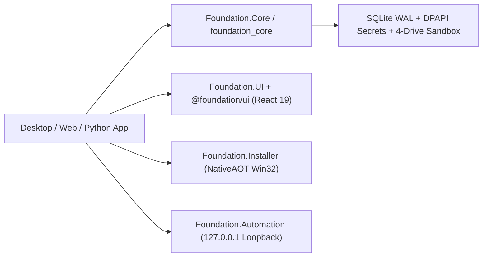

# Foundation (`v0.5.6` — Beta)

[](https://github.com/StreamItAllGit/Foundation/releases)
[](https://streamitallgit.github.io/Foundation/)
[](https://github.com/StreamItAllGit/Foundation/actions/workflows/ci.yml)
[](LICENSE)


> **Release Status:** **Beta (`v0.5.6` — Pre-1.0)**. Foundation and all sibling projects default to Beta until explicitly promoted out of Beta at `v1.0.0`.

**Modular `.NET 8`, React/TypeScript, and pure-stdlib Python SDK** for Windows desktop apps, installers, sandboxing, SQLite persistence, and UI automation.

> **Highlights in `v0.5.6`:** NativeAOT-ready Win32 P/Invoke `Foundation.Installer` (zero WinForms/runtime bloat) + slim embedded uninstaller extraction + Start Menu collision guard, pure-stdlib Python `foundation_core.{secrets,sidecars}` DPAPI/hash-sidecar parity, lock-free `SqliteWalPool` WAL init, and verified ReleaseHub GitHub/R2 fallback updates ([full release notes](CHANGELOG.md#056---2026-11-28)).



---

## 1. Hello World (Consumer Quickstart)

```csharp
using Foundation.Core;

var env = new AppEnvironment("myapp", args);
var walPool = new SqliteWalPool(Path.Combine(env.DataDirectory, "app.db"));
await using var conn = await walPool.OpenConnectionAsync();
```

```python
from foundation_core import DpapiSecretStore, open_wal_sqlite, parse_standard_cli_flags

opts = parse_standard_cli_flags(app_name="MyApp", app_version="0.1.0")
DpapiSecretStore(opts.data_dir).set_secret("apiToken", "example")
with open_wal_sqlite(opts.data_dir / "app.db") as conn:
    conn.execute("SELECT 1").fetchone()
```

---

## 2. Documentation & Navigation Map

| What You Need | Destination | Summary |
|---|---|---|
| C# APIs, React props, Python helpers, CLI flags & JSON schemas | [Dev/docs/INTERFACES.md](Dev/docs/INTERFACES.md) | 1-stop API dictionary & `@foundation/ui` import guide |
| Copy-paste integration recipes | [Dev/docs/USER_GUIDE.md](Dev/docs/USER_GUIDE.md) | Quickstart recipes for installers, UI automation, Web UI, Python, Core & 4-drive sandboxes |
| Architecture, file registry, SQLite pragmas & ADRs | [Dev/docs/ARCHITECTURE.md](Dev/docs/ARCHITECTURE.md) | Dependency graph, runtime pipelines, SLOC inventory & ADR notes |
| Build, test, SDK publish & sandbox CLI commands | [Dev/docs/OPERATIONS.md](Dev/docs/OPERATIONS.md) | Exact build/sync/release commands, exit codes & operational runbooks |
| Features, roadmap & version history | [FEATURES.md](FEATURES.md) · [ROADMAP.md](ROADMAP.md) · [CHANGELOG.md](CHANGELOG.md) | Module inventory, milestone horizon & Keep a Changelog ledger |
| Security policy & contributing | [SECURITY.md](SECURITY.md) · [CONTRIBUTING.md](CONTRIBUTING.md) | Security invariants, vulnerability disclosure & PR workflow |

---

## 3. Subproject Architecture Overview (`v0.5.6` — Beta)

- **C# Core & Runtime (`Dev/src/Foundation.Core/` — `27` files, `net8.0`):**
  - Environment, sandboxing & registry: [`AppEnvironment`](Dev/src/Foundation.Core/AppEnvironment.cs) (`--data-dir`, `--config`, `--log-dir`, `--port`, `--dry-run`, `UiPresentationMode`), [`KnownFolderPaths`](Dev/src/Foundation.Core/KnownFolderPaths.cs) (with child-`USERPROFILE` `Desktop`/`Documents`/`AppData` unmapping), [`SandboxEnvironmentSeam`](Dev/src/Foundation.Core/SandboxEnvironmentSeam.cs) (`ExitCode = 3` containment guards with Windows 8.3 `GetLongPathNameW` normalization), [`JsonHivePlatformRegistry`](Dev/src/Foundation.Core/JsonHivePlatformRegistry.cs) (`IPlatformRegistry` atomic `.tmp -> .bak` hive + `WindowsPlatformRegistry`), [`SandboxDriveController`](Dev/src/Foundation.Core/SandboxDriveController.cs).
  - Resiliency, media & primitives: [`HighResFramePacer`](Dev/src/Foundation.Core/HighResFramePacer.cs) (with VRR late-latch `BeginLateLatchFrame` / `WaitBeforePresent*`), [`AudioRingBuffer`](Dev/src/Foundation.Core/AudioRingBuffer.cs), [`WavCaptureWriter`](Dev/src/Foundation.Core/WavCaptureWriter.cs), [`RgbaPngWriter`](Dev/src/Foundation.Core/RgbaPngWriter.cs), [`PixelOverlayCanvas`](Dev/src/Foundation.Core/PixelOverlayCanvas.cs), [`QrCodeEncoder`](Dev/src/Foundation.Core/QrCodeEncoder.cs) (zero-dependency ISO/IEC 18004 V1–V10 ECC-M QR matrix & SVG renderer), [`GranularSettingsManager`](Dev/src/Foundation.Core/GranularSettingsManager.cs), [`RollingFileBackupStore`](Dev/src/Foundation.Core/RollingFileBackupStore.cs) (rotating `.tmp -> .bak` snapshots with bounded pruning), [`DpapiSecretStore`](Dev/src/Foundation.Core/DpapiSecretStore.cs), [`SqliteWalPool`](Dev/src/Foundation.Core/SqliteWalPool.cs), [`PidSafeLockfile`](Dev/src/Foundation.Core/PidSafeLockfile.cs), [`HeartbeatLogger`](Dev/src/Foundation.Core/HeartbeatLogger.cs), [`CrashBundleService`](Dev/src/Foundation.Core/CrashBundleService.cs), [`JobObjectGuard`](Dev/src/Foundation.Core/JobObjectGuard.cs), [`SafeNetworkTransfer`](Dev/src/Foundation.Core/SafeNetworkTransfer.cs) (`DownloadVerifiedAsync` with HTTPS-only, SSRF/cloud-metadata IP & DNS blocking, validated redirects, TLS 1.2/1.3, and byte-size checks), [`ToolResolver`](Dev/src/Foundation.Core/ToolResolver.cs), [`HybridModuleLoader`](Dev/src/Foundation.Core/HybridModuleLoader.cs).
- **Retro & Sidecar Libraries (`Dev/src/Foundation.Retro/` [`8` files] + `Dev/src/Foundation.Sidecars/` [`5` files], `net8.0`):**
  - 41-platform catalog (`ConsoleSystemCatalog`), No-Intro/Redump/RA/CMP streaming DAT parser, headerless ROM stripper + binary magic sniffer, IPS/BPS/UPS soft patcher, [`MediaContainerExtractor`](Dev/src/Foundation.Retro/MediaContainerExtractor.cs) (`.iso`, `.bin`+`.cue`, `.chd`, `.7z`, `.zip`), static recompilation contracts ([`RecompContracts`](Dev/src/Foundation.Retro/RecompContracts.cs), [`RecompTierAndBackendContracts`](Dev/src/Foundation.Retro/RecompTierAndBackendContracts.cs)), single-pass multi-hasher, ZIP/7z `-slt` inspector + TorrentZip builder, `.hash` v1 sidecars, and `.hklock` / `.coexistence.json` v2 coordination.
- **Server, Launcher, UI, Installer & Automation (`net8.0` / `net8.0-windows`):**
  - **Web & Auth Server (`Foundation.Server`, `3` files):** Tiered localhost/Tailscale/PBKDF2/HMAC authentication and `/api/v1/suite/manifest` endpoints.
  - **Clean-Root Launcher (`Foundation.Launcher`, `2` files):** [`RootLauncherHost`](Dev/src/Foundation.Launcher/RootLauncherHost.cs) + [`RootLauncherOptions`](Dev/src/Foundation.Launcher/RootLauncherOptions.cs) (zero-dependency `AttachConsole(-1)` shim, extensible sync/value/path flags including suite diagnostics/automation switches, non-swallowing optional flags, relative arg rebasing, Ctrl+C forwarding).
  - **Desktop & Web UI (`Foundation.UI` + `@foundation/ui`):** `AppEnvironment`-aware [`DisposableWebViewHostForm`](Dev/src/Foundation.UI/Desktop/DisposableWebViewHostForm.cs), STA dialogs, tray badges, React 19 UI components, and Vanilla ES terminal drawer.
  - **Declarative, Ownership-Guarded & Dual Online/Offline Installer (`Foundation.Installer`):** NativeAOT-ready Win32 [`StandardInstallerHost`](Dev/src/Foundation.Installer/StandardInstallerHost.cs), declarative [`InstallerManifestStore`](Dev/src/Foundation.Installer/InstallerManifestStore.cs) (`installer.manifest.json` `schemaVersion: 2`, canonical `suiteId` with `suiteName` legacy fallback, `installerDeliveryKind` [`onlineSetup` / `offlineSetup` / `portableZip`], `payloadDownloadUrl`, `payloadFallbackUrls`, `betaPin`, `payloadAssets[]`, `single-line` / `multi-line`, `lightweight` / `full` / `custom`, 2-line tooltips, theme tokens, slim embedded `.uninstaller.exe.gz` extraction), [`InstallerEngine.Ownership.cs`](Dev/src/Foundation.Installer/InstallerEngine.Ownership.cs) (`ProductName` directory-ownership guard with `ProductMismatch:` refusal + `FOREIGN APP DETECTED` badge and wildcard-free uninstaller/trampoline cleanup), [`InstallerEngine.OnlinePayload.cs`](Dev/src/Foundation.Installer/InstallerEngine.OnlinePayload.cs) (HTTPS + SHA-256 + byte-size verified downloads & `--offline-bundle <zipOrDir>` fallback), Start Menu file-collision guard, single-profile radio collapse, and self-healing `HKCU\Software\StreamItAll\LastInstallBaseDir` fresh-install memory.
  - **Focus-Free UI Automation (`Foundation.Automation`, `5` files):** Opt-in `127.0.0.1` loopback server ([`AutomationLoopbackServer`](Dev/src/Foundation.Automation/AutomationLoopbackServer.cs)) with Bearer `401` + `Host`/`Origin` `403` enforcement, WinForms-free [`IAutomationSurfaceTarget`](Dev/src/Foundation.Automation/AutomationContracts.cs) + [`AutomationCliHelper`](Dev/src/Foundation.Automation/AutomationCliHelper.cs) (`TryCreateForSurface` + `WinFormsAutomationSurfaceTarget`), focus-free managed mouse dispatch (`Win32VirtualInputDriver`, `0` `SendInput` or `SetFocus()` steals) & window-scoped keyboard/tree inspection, and PNG window/framebuffer snapshots (`POST /v1/snapshot` & in-memory `GET /v1/snapshot.png`).
- **Python SDK & Dev Tooling ([`Dev/src/foundation_core/`](Dev/src/foundation_core/) + [`Dev/tools/`](Dev/tools/)):**
  - Pure-stdlib Python `foundation_core` (`0.5.6`, `dependencies = []`) with 1:1 C# 4-drive sandbox (`sandbox_seam.py` with 8.3 `GetLongPathNameW` and child-`USERPROFILE` unmapping) and atomic JSON pseudo-registry (`pseudo_registry.py`) parity, Windows `crypt32` DPAPI secret vault (`secrets.py`), streaming hashing / `.hash` v1 / `.archive_hashes.json` / `.hklock` sidecars (`sidecars.py`), subcommand `--help` CLI passthrough and `<data_dir>/config/settings.json` defaults (`cli.py`), `GranularSettingsStore` (`settings.py`), `PRAGMA user_version` SQLite WAL + read-only `VACUUM INTO` integrity checks (`db.py`), `±2s` PID-reuse verification + heartbeats (`locks.py`), structured ring-buffered logging (`logging.py`), Zero-PII crash JSON bundles (`crash_dumper.py`), and loopback HTTP + PNG snapshot parity (`automation.py`), plus universal sandbox orchestration (`sandbox_ctl.py`), 12-point isolated sandbox E2E verification (`run_sandbox_e2e.py`), WebSocket + UDP live GUI stream helpers (`ExeboxStreamHelpers.ps1` / `exebox_stream.py`), and hardlink-safe atomic release validation scripts.

---

## 4. Build & Test Verification

### Prerequisites
- **.NET 8 SDK** (`net8.0` cross-platform libraries + `net8.0-windows` NativeAOT-ready Win32 Installer / UI / Automation targets)
- **Python 3.12+** (`unittest` works with stdlib only; `pytest` optional)

```powershell
# 1. Clone repository and run isolated .NET test suite (zero warnings required)
git clone https://github.com/StreamItAllGit/Foundation.git
cd Foundation
$env:FOUNDATION_SUPPRESS_MODALS = "1"
dotnet test Dev/Foundation.sln -c Release -p:TreatWarningsAsErrors=true

# 2. Run Python foundation_core & tools test suite
python -m unittest discover -s Dev/tests/foundation_core -v

# 3. Publish compiled SDK snapshot (DLLs, @foundation/ui, foundation_core, tools)
python Dev/tools/sync_foundation_sdk.py --publish --version 0.5.6 --ui-version 0.5.6 --configuration Release

# 4. Sync pinned SDK into a downstream consumer directory
python Dev/tools/sync_foundation_sdk.py --sync-consumer path/to/ConsumerProject

# 5. Initialize 4-drive sandbox and run 12-point isolated E2E verification
python Dev/tools/sandbox_ctl.py init
python Dev/tools/run_sandbox_e2e.py --app-id myapp --version 0.1.0 --installer path/to/Setup.exe
```

> **Note on `PublishFoundationSdk`:** Building `Foundation.UI.csproj` with `-p:PublishFoundationSdk=true` updates `WebAssets/` and publishes to the local `SharedLibs/Foundation/Latest/` snapshot directory.

---

## 5. Releases, Governance & License

- **GitHub Beta Releases:** [github.com/StreamItAllGit/Foundation/releases](https://github.com/StreamItAllGit/Foundation/releases) (`v0.5.6` Beta SDK ZIP, release notes & SHA-256 checksums)
- **Lifecycle State:** [active.state](active.state) (`v0.5.6` — Beta, Public Repository)
- **License:** Distributed under the [MIT License](LICENSE).
- **Security & Contributing:** See [SECURITY.md](SECURITY.md) and [CONTRIBUTING.md](CONTRIBUTING.md).
- **Clean-Room & Zero-PII Guarantee:** Contains zero copyrighted ROMs, BIOS dumps, proprietary keys, or workstation-specific credentials/paths.

---

## 6. Code Signing Policy

Free code signing provided by [SignPath.io](https://signpath.io/), certificate by [SignPath Foundation](https://signpath.org/).

- **Authors:** Repository contributors and maintainers ([`@StreamItAllGit`](https://github.com/StreamItAllGit))
- **Reviewers:** Repository maintainers ([`@StreamItAllGit`](https://github.com/StreamItAllGit))
- **Approvers:** Repository owners ([`@StreamItAllGit`](https://github.com/StreamItAllGit))
- **Privacy Policy:** This program will not transfer any information to other networked systems unless specifically requested by the user or the person installing or operating it.

---

## 7. Technical Manuals (`Dev/docs/`)

- **Documentation Site (GitHub Pages):** [https://streamitallgit.github.io/Foundation/](https://streamitallgit.github.io/Foundation/) — Browsable HTML reference built automatically by [`.github/workflows/pages.yml`](.github/workflows/pages.yml)
- [Dev/docs/INTERFACES.md](Dev/docs/INTERFACES.md) — **API Dictionary** (C# classes/signatures including `RollingFileBackupStore`, `SafeNetworkTransfer.DownloadVerifiedAsync`, `QrCodeEncoder`, `Foundation.Automation` `IAutomationSurfaceTarget`, `InstallerManifestStore`, `@foundation/ui` props, Vanilla JS/CSS, `foundation_core`, `Dev/tools/*` CLIs & JSON schemas)
- [Dev/docs/USER_GUIDE.md](Dev/docs/USER_GUIDE.md) — Consumer Integration Recipes, Ownership Guard, Dual Online/Offline Setup, `Foundation.Automation` Loopback, Python `foundation_core` & 4-Drive Sandbox Quickstart
- [Dev/docs/ARCHITECTURE.md](Dev/docs/ARCHITECTURE.md) — System Topology, Runtime Pipelines, Complete Module Registry, SQLite Pragmas & ADR Notes
- [Dev/docs/OPERATIONS.md](Dev/docs/OPERATIONS.md) — Build, Hub Sync, 4-Drive Sandbox & Exebox Stream CLIs, Dual-Installer Release Validation & Exit Codes
